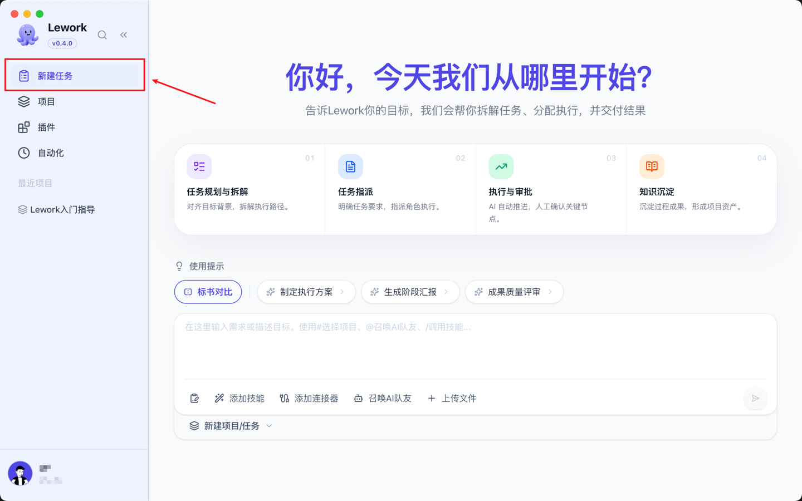
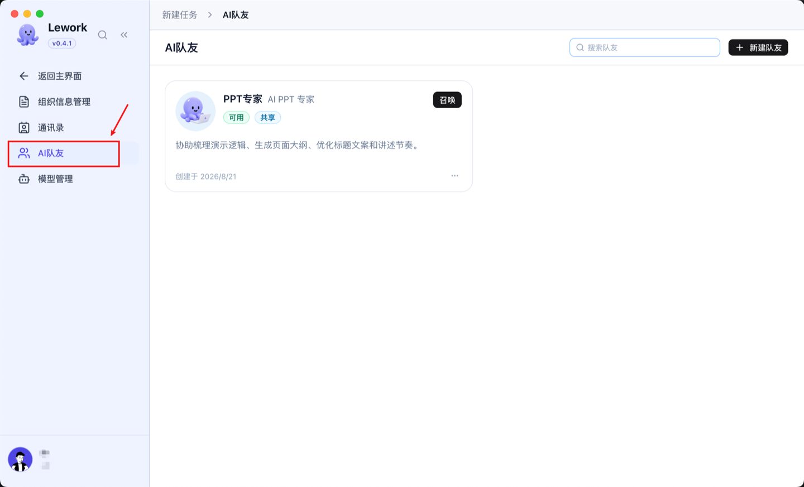
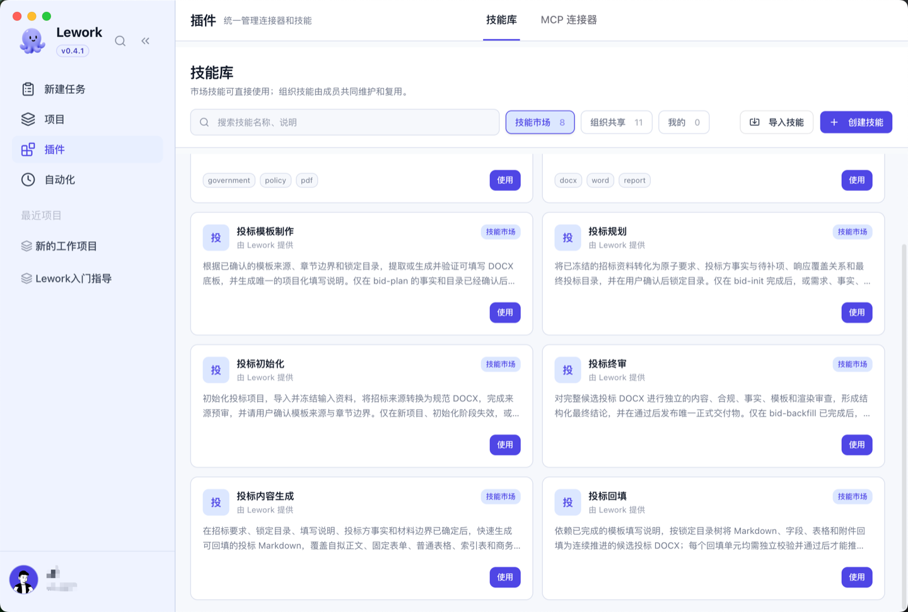
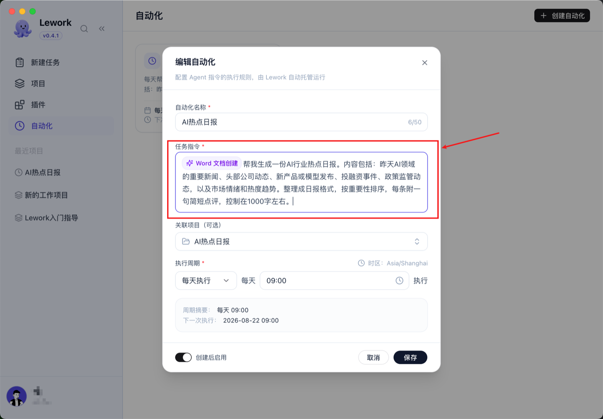
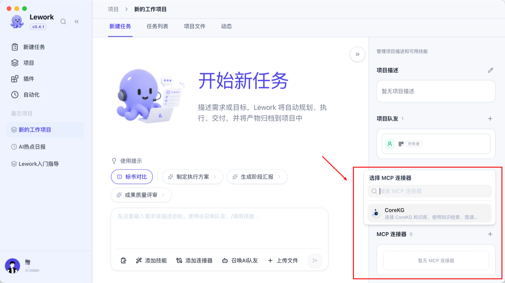

<div align="center">

<!--
  Asset notes:
  - Badges (license / go / web / protocol-mcp / website): self-contained SVGs bundled in the repo at docs/images/badges/ — no external network dependency.
  - Logo: docs/images/logo.png (original source: docs/images/logo.svg).
-->


# Lework

Open-Source Enterprise AI Work Platform — turning AI from a chat tool into a **team member that collaborates long-term, delivers results, and accumulates experience**.

> Give AI a project, a role, and a task. It executes independently; you review the outcome.

[](./LICENSE)


[](https://lework.ai/)

**Contents** · [What is Lework?](#what-is-lework) · [UI Preview](#ui-preview) · [Understand in a Minute](#understand-in-a-minute) · [Collaboration Flow](#collaboration-flow) · [Core Features](#core-features) · [System Architecture](#system-architecture) · [Quick Start](#quick-start) · [Development Guide](#development-guide) · [MCP Server](#mcp-server) · [Ecosystem & Synergy](#ecosystem--synergy) · [Related Documents](#related-documents) · [Contributing](#contributing) · [Community & Support](#community--support) · [License](#license)

</div>

---

## What is Lework?

Lework is an open-source AI work platform for enterprises and teams. It is the **enterprise-grade digital employee / AI teammate** in the enterprise AI product matrix of [Smart Matrix (insmtx)](https://insmtx.com/) (official website: [lework.ai](https://lework.ai/)), and it works in synergy with **CoreKG** (the enterprise knowledge engine) from the same matrix: CoreKG provides knowledge supply, while Lework handles task execution and experience accumulation.

It is not just another open chatbot, nor a mere workflow orchestration engine. Lework treats AI as **manageable productivity** — AI-assisted work is becoming more common, but its output is often not captured; when the conversation ends, everything resets to zero. Lework solves the problems of **no division of labor, no assignment, no deliverables, and no tracking**:

- 👥 **Build a team** — define roles, bind skills, and create AI teammates;
- 📋 **Assign tasks** — specify the owner, expected output, and acceptance criteria;
- 📦 **Get results** — AI executes independently and delivers traceable artifacts;
- 🧠 **Accumulate assets** — context and outputs keep accumulating, improving with use;
- 📊 **Manageable** — progress, quality, and call cost, visible and controllable end to end.

### Core Entities

| Entity | What it does | What it delivers |
|---|---|---|
| **Project** | Defines the collaboration boundary, carrying goals and context | Project-level asset overview |
| **Task** | Assigns an AI teammate and specifies output requirements | Acceptance-ready deliverables |
| **AI Teammate** | An AI executor with a clear role, job description, skills, and permission boundaries | An executor that completes tasks independently |
| **Skill** | A reusable working method and execution process | Code, reviews, tests, reports, etc. |
| **MCP Connector** | Provides access to external systems / tools (e.g. a CoreKG knowledge base) | Enterprise knowledge, external tool access |
| **Automation** | Runs automatically at a set cadence with a fixed task command and skills | Periodically produced results |
| **Knowledge Base** | Accumulates context and conventions | No need to re-explain background repeatedly |
| **Project Assets / Files** | Browse all historical deliverables | Traceable and reusable at any time |

### Tech Stack

- The server is a **Go monorepo** (module `github.com/insmtx/Lework`, Go 1.25) that can be deployed as one aggregated monolith or split on demand;
- The frontend is a **pnpm + turbo monorepo** under `frontend/`, including the main Web UI (Next.js / React / TypeScript) and a desktop application;
- Tasks and events are distributed over **NATS JetStream**; agent execution is handled by `backend/agent`, supporting multiple runtimes such as native / claude / codex / opencode;
- A built-in **MCP Server** (exposes Lework's runtime capabilities externally), which at the same time acts as an **MCP client** connecting external systems and knowledge bases through connectors (e.g. CoreKG).

## UI Preview

**Desktop Workbench** (create tasks, plan and decompose work, @-mention AI teammates):

<p align="center"></p>

**AI Teammates** (browse, summon, and create AI teammates):

<p align="center"></p>

**Plugins · Skill Library** (discover, import, and associate skills; manage MCP connectors):

<p align="center"></p>

**Automation** (run automatically at a set cadence with a fixed command and skills):

<p align="center"></p>

**Connect a CoreKG Knowledge Base** (retrieve enterprise knowledge in tasks via an MCP connector, add context, and link sources):

<p align="center"></p>

## Understand in a Minute

Imagine you have an AI team:

```
Project: New Admin System for a Product

  ├── AI Teammate · Architect (role: technical decisions, skills: system design review)
  ├── AI Teammate · Developer 1 (role: backend development, skills: Go programming, API design)
  ├── AI Teammate · Developer 2 (role: frontend development, skills: React, component library)
  ├── AI Teammate · QA (role: quality assurance, skills: test case generation, regression testing)
  └── AI Teammate · PM (role: progress management, skills: daily report generation, risk identification)

  ├── Task: design the user permission model → assigned to the Architect
  ├── Task: implement the login API → assigned to Developer 1
  ├── Task: build the login page → assigned to Developer 2
  └── Task: write integration tests → assigned to QA
```

**Each AI teammate has its own role, skills, permission boundaries, and memory.** You create tasks, assign teammates, and track progress — they execute independently and produce code, documents, and reports. When execution completes, the artifacts are accumulated into the knowledge base, so the next similar task no longer requires re-explaining the context.

## Collaboration Flow

```
  💬 Project conversation (discuss requirements, align on the approach)
        ↓   direction confirmed
  📋 Create a task (define the goal, expected output, assign an AI teammate)
        ↓
  ⚙️ AI teammate executes autonomously (invoke skills, produce intermediate results)
        ↓
  ✅ Human approval / takeover / additional context (at key checkpoints)
        ↓
  📦 Deliver project assets (documents / code / reports / structured data)
        ↓
  🧠 Accumulate into the knowledge base (no need to re-explain next time)
```

Every step is auditable, traceable, and can be paused or adjusted. **Standard execution** suits tasks with clear goals; **planning mode** suits complex tasks — AI first lays out the steps, scope, and execution plan, then proceeds to actual work once the plan is confirmed. Through MCP, API, CLI, and GUI automation, the platform connects to enterprise tools and business systems, covering the main phases from requirement understanding and collaborative execution to deliverable handover.

## Core Features

### Task-Driven Collaboration

| Capability | Description |
|---|---|
| Project management | Projects act as the collaboration boundary, carrying goals, members, and context |
| Task system | Define the goal, expected output, and acceptance criteria; assign AI teammates |
| AI teammates | Role division, skill binding, permission boundaries, and independent memory |
| Multi-agent orchestration | Automatically decomposes the workflow by task goal and schedules multiple sub-agents to run in parallel, each with its own context and execution state |
| Skill library | Discover, install, import, and manage skills (reusable working methods and execution processes); call them directly for similar tasks |

### Enterprise-Grade Governance

| Capability | Description |
|---|---|
| Multi-tenant isolation | Data and execution environments are fully isolated between enterprises |
| RBAC access control | Three-level permissions across users, AI teammates, and skills |
| Execution audit | Full-chain traceability and replay for every task execution |
| Cost tracking | Model call costs aggregated by task, project, and team |
| Secret security | API key custody and masking |
| Approval workflows | Configurable human approval gates for critical operations |
| Private deployment | Supports deployment on enterprise internal infrastructure |

### Capability Integration

| Capability | Description |
|---|---|
| Tool calling | Connect knowledge bases, MCP connectors, browsers, and external systems |
| MCP connectors | As an MCP client, access external systems / tools (e.g. a CoreKG knowledge base); must be associated with a project before use |
| MCP Server | A built-in MCP Server (StreamableHTTP) that exposes Lework's runtime capabilities externally — see [MCP Server](#mcp-server) |
| Automation | AI teammates execute automatically at a set cadence with a fixed task command and skills |
| Planning mode | For complex tasks, AI first lays out the steps, scope, and execution plan; execution begins only after confirmation |
| Multiple runtimes | Agent runtimes such as native / claude / codex / opencode |
| Shared memory | Records project background, historical tasks, team preferences, and execution context — the longer the collaboration, the better it understands your business |

**Authentication**

Lework supports two authentication modes, selected via compile-time build tags:

| Mode | Description | Build command |
|---|---|---|
| **builtin** (default) | Built-in email / phone / Worker Token authentication, used by the open-source edition | `go build -o ./bundles/lework ./backend/cmd/lework/` |
| **enterprise** | Delegates to the IAM (identity and access management) service, used by the enterprise edition | `go build -tags enterprise -o ./bundles/lework ./backend/cmd/lework/` |

The enterprise edition requires configuring the IAM service address in `config.yaml`:

```yaml
auth:
  mode: "enterprise"
  iam:
    base_url: "https://iam.example.com/v5"
```

No `auth` block is needed out of the box — the built-in authentication is used by default.

## System Architecture

```
Browser / Desktop / Agent / MCP Client
        │  HTTP / WebSocket
        ▼
Frontend Lework Web (Next.js) + Desktop (frontend/, pnpm + turbo monorepo)
        ▼
Go service layer — lework (aggregated entrypoint at backend/cmd/lework, :8080)
   · server     HTTP API + command entrypoints (chat / session / task / project / skill / login)
   · worker     async tasks / agent execution worker
   · agent      execution core: runtime → adapter → executor → tool / interaction / node_event
        │
        ├─▶ Messaging & events (NATS JetStream)
        ├─▶ Storage layer (PostgreSQL · local/object storage)
        └─▶ MCP Server (backend/internal/worker/mcp, StreamableHTTP)
```

- Layering and package structure: see [docs/architecture/backend.md](docs/architecture/backend.md) and [docs/architecture/overview.md](docs/architecture/overview.md);
- Agent execution core and runtimes: see [docs/architecture/agent-runtime.md](docs/architecture/agent-runtime.md) and [docs/architecture/workspace-artifact.md](docs/architecture/workspace-artifact.md);
- Design philosophy: see [docs/architecture/design-philosophy.md](docs/architecture/design-philosophy.md).

## Quick Start

### Prerequisites

- Git
- Docker and Docker Compose (recommended one-command deployment path)
- Host development mode only: Go 1.25+, Node.js / pnpm (frontend)

### Configuration Conventions

All runtime configuration containing secrets / connection strings is **never committed**; the repo only ships `*.example` templates. Copy them to real files and fill in the placeholder values:

```bash
git clone https://github.com/insmtx/Lework.git
cd Lework
git config pull.rebase true

# Copy the config template (see config.example.yaml at the repo root)
cp config.example.yaml config.yaml
# Edit config.yaml and replace change-me / placeholder values with real ones
```

### Option 1: Docker Compose One-Command Startup (recommended)

```bash
# 1) Prepare the runtime configuration (see "Configuration Conventions" above)
# 2) Build and start (builds the localhost/env_lework image, then brings up PostgreSQL / NATS / lework / worker)
make docker-compose-up
# If the image is already built, start directly with docker-compose
make run-detached
docker compose -f deployments/env/docker-compose.yml up -d
```

After startup:

- The server API is at **http://localhost:8080** (the `lework` container, `server --config`)
- The NATS JetStream message-bus monitor is at **http://localhost:8222**
- The frontend Web UI listens at **http://localhost:3005** by default

Ports / credentials / initialization details for the middleware are described in [docs/operations/private-deployment-guide.md](docs/operations/private-deployment-guide.md).

### Option 2: Host Development Mode

```bash
make dev-setup      # one-time initialization (create database, dependencies, config)
make dev-server     # run the backend server on the host
make dev-worker     # run the async worker on the host
make dev-frontend   # frontend development container
```

> Build / run commands and image targets are in the [Makefile](Makefile). Commands and configuration are described in [docs/operations/private-deployment-config.md](docs/operations/private-deployment-config.md) and [docs/operations/project-structure.md](docs/operations/project-structure.md).

## Development Guide

### Repository Structure

```
Lework/
├── backend/            # Go backend (cmd/lework is the process entrypoint)
│   ├── cmd/lework/      #   cobra commands: server / worker / chat / session / task / project / skill / login, etc.
│   ├── agent/          #   execution core (runtime / adapter / executor / tool / interaction / node_event)
│   ├── internal/       #   business logic (adapter, api, infra, service, worker, modelrouter, llm, etc.)
│   ├── tools/          #   Tool registry + concrete tools (artifact_declare, memory, node, skill_manage, skill_use, todo)
│   ├── types/          #   domain types + DB table constants
│   └── config/         #   configuration
├── frontend/           # Frontend (pnpm + turbo monorepo: @lework/web, @lework/desktop)
├── deployments/        # Docker / private deployment
├── docs/               # Documentation (architecture / product / design / frontend / operations / swagger)
├── config.example.yaml / minimal-config.yaml
├── Makefile / go.mod / AGENTS.md / CHANGELOG.md / CONTRIBUTING.md / LICENSE
```

### Common Commands

```bash
# Build the backend (builtin authentication by default)
make build                       # → bundles/lework
# Enterprise build (authentication delegated to IAM)
make build BUILD_TAGS=enterprise

# Run locally (docker-compose)
make run / make run-detached / make stop / make logs

# Development
make dev-setup / dev-server / dev-worker / dev-frontend

# API documentation
make swagger                     # generates docs/swagger

# Tests
go test ./...                    # default (excludes integration / enterprise)
go test ./backend/internal/<pkg>
```

### Conventions & Notes

- **Module path**: every internal import uses the `github.com/insmtx/Lework/...` prefix;
- **Strict layering**: `cmd/lework` (process entrypoint, lifecycle only) → `agent/**` (business-agnostic execution core) → `internal/**` (business logic) → `types/` / `config/` (shared types). Cross-layer boundaries and hard rules are in [AGENTS.md](AGENTS.md) at the repo root;
- **Tests are not isolated**: most package-level tests depend on real middleware (PostgreSQL / NATS); start `make dev-up` before running the relevant package tests;
- **Never hand-edit generated files**: `docs/swagger/` (generated by swag) and similar generated files must not be edited manually.

## MCP Server

In the MCP ecosystem, Lework plays a **dual role**: it acts as an **MCP Server** exposing its own capabilities, and as an **MCP client** (connector) that accesses external systems and knowledge bases.

### Exposing Capabilities (MCP Server)

`backend/internal/worker/mcp` ships a built-in **MCP (Model Context Protocol) Server** that exposes Lework's runtime capabilities over the standard protocol, so AI agents can directly plug Lework in as a callable "colleague".

| Item | Description |
|---|---|
| Transport | StreamableHTTP (MCP server side, `backend/internal/worker/mcp`) |
| Exposed capabilities | Lework tools registered through `tools.Tool` (e.g. `skill_manage`) mapped to MCP tools |
| Authentication | Instance-level token authentication (`NewServerWithToken`) |

For the tool list and how to connect, see the in-repo implementations: `backend/internal/worker/mcp` and `backend/tools/`.

### Accessing External Systems (MCP Connectors)

External system connections are managed under "Plugins → MCP Connectors", providing **access to** external systems / tools (as opposed to **skills**, which describe reusable methods). A connector must be associated with a target project before the task runtime will use it. A CoreKG knowledge base is one such MCP "platform connector", used to retrieve enterprise knowledge during tasks, add context, and link sources.

## Ecosystem & Synergy

Lework is a member of the [Smart Matrix (insmtx)](https://insmtx.com/) enterprise AI product matrix, working in synergy with the other products in the matrix to form a closed loop from capability supply to business execution:

| Product | Role | Description |
|---|---|---|
| **[Lework](https://lework.ai/)** | Enterprise AI work platform / digital employee | Receives and executes tasks as a real project member, delivers results, and accumulates Skills and project memory (this repository) |
| **[CoreKG](https://corekg.com/)** | Enterprise AI knowledge engine | Multi-source knowledge ingestion, governance, understanding, and retrieval, providing knowledge Q&A, knowledge graphs, and citation traceability; in Lework it is accessed as an MCP "platform connector" so tasks can retrieve enterprise knowledge, add context, and link sources |
| [CatAPI](https://catapi.insmtx.com/) | AI capability open platform | Provides mature AI capabilities such as document parsing / OCR / structured extraction through standard APIs |
| [Insmtx Cloud](https://insmtx.com/) | LLM management platform | Model access, intelligent routing, permission and usage management |
| [Insmtx 20](https://insmtx.com/all-in-one) | All-in-one AI appliance | Local GPU, pre-installed models, private compute running on the intranet |

**Synergistic data flow**: `Enterprise data → CatAPI / CoreKG (knowledge supply) → Lework (task execution & experience accumulation) → continuous feedback of Skills / project memory / enterprise knowledge`.

**How the CoreKG integration works**: In Lework, CoreKG is connected as an MCP "platform connector" (Plugins → MCP Connectors). First confirm on the plugins page that CoreKG is "Connected", then associate the connector with the target project; when creating a task, specify the retrieval scope, keywords, and output format, and the AI will answer based on enterprise knowledge with traceable sources. If no connector is associated with the project, tasks will not automatically use that knowledge base.

In a word: **CoreKG makes enterprise knowledge "visible, findable, accurately answerable, and usable", while Lework puts that knowledge — together with digital employees — to work actually completing tasks**; together they form the enterprise intelligence closed loop of the Smart Matrix.

## Related Documents

| Document | Content |
|---|---|
| [docs/architecture/overview.md](docs/architecture/overview.md) | AI OS architecture design (three-core architecture) |
| [docs/architecture/backend.md](docs/architecture/backend.md) | Backend package structure design |
| [docs/architecture/agent-runtime.md](docs/architecture/agent-runtime.md) | Agent Runtime architecture |
| [docs/architecture/workspace-artifact.md](docs/architecture/workspace-artifact.md) | Agent workspace and artifact design |
| [docs/design/tech-design.md](docs/design/tech-design.md) | Technical design (skill schema, rendering engine) |
| [docs/product/prd.md](docs/product/prd.md) | Product requirements document |
| [docs/product/planning.md](docs/product/planning.md) | Roadmap planning |
| [docs/product/lework-product-whitepaper.md](docs/product/lework-product-whitepaper.md) | Product capability whitepaper |
| [docs/operations/private-deployment-guide.md](docs/operations/private-deployment-guide.md) | Private deployment guide |
| [docs/operations/project-structure.md](docs/operations/project-structure.md) | Project structure index |
| [frontend/README.md](frontend/README.md) | Frontend development guide |
| [lework.ai](https://lework.ai/) | Lework official website (product capabilities / technical architecture / private deployment options) |
| [insmtx.com/products](https://insmtx.com/products) | Smart Matrix product portfolio (CoreKG · Lework · CatAPI, etc.) |

## Contributing

We welcome all forms of contribution — Issues, documentation, code, and usage feedback.

- **File an Issue**: report bugs or suggest features at [GitHub Issues](https://github.com/insmtx/Lework/issues);
- **Submit a PR**: Fork this repository → create a feature branch → commit your changes → open a Pull Request. Opening an Issue to discuss the design first is recommended;
- **Development conventions**: before you start, read [AGENTS.md](AGENTS.md) at the repo root (repository structure, engineering and code conventions) and the [Development Guide](#development-guide) above;
- **Database migrations**: follow the migration conventions in this repository (see [AGENTS.md](AGENTS.md) and `docs/`).

## Community & Support

- Usage questions / bug reports: [GitHub Issues](https://github.com/insmtx/Lework/issues)
- Feature requests & discussions: same place, please tag them with `feature` / `discussion`
- Official website: [lework.ai](https://lework.ai/)
- **📰 Recent news**: latest promotion articles on our WeChat official account ([read more](https://mp.weixin.qq.com/s/cqudtC3wBAQqLk509HsTWA))

## License

Lework is licensed under the **[Lework Open Source License](./LICENSE)**: based on Apache License 2.0, with additional commercial-use conditions (the English text is legally binding). For specific cases such as multi-tenant SaaS, the LOGO and copyright information, contact the maintainer for a commercial license — see the LICENSE file for details.
