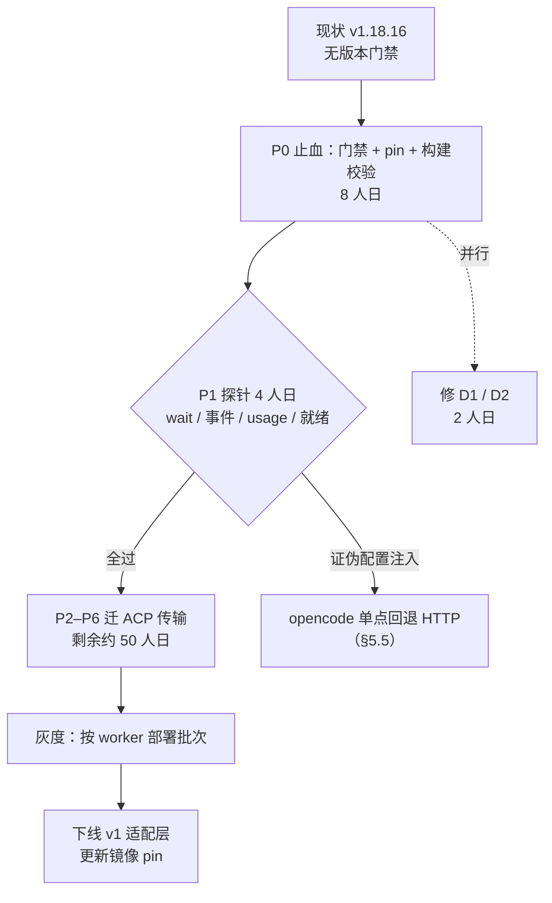
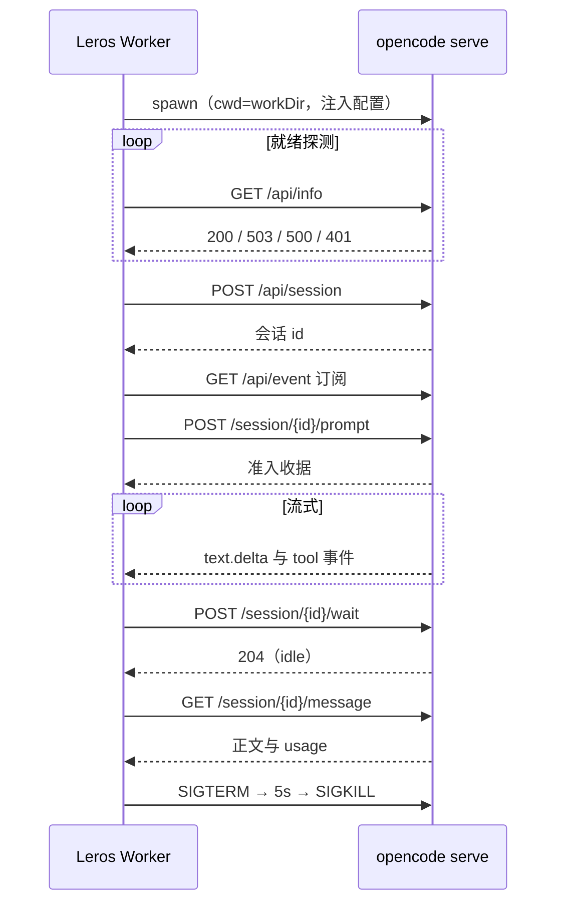

# opencode v2 迁移方案与成本评估（协议选型：HTTP API vs ACP）

> 状态：草案待评 ｜ 作者：AI 助手（源码取证） ｜ 评审人：opencode runtime owner、部署/镜像 owner、产品（计划模式语义）、前端 owner ｜ 拍板人：技术负责人（协议与档期）＋ 产品负责人（计划模式是否可降级） ｜ 最后更新：2026-10-27

| 项目 | 内容 |
|---|---|
| 前置结论 | **迁移到 v2 已决策**，本文只回答「用哪条协议」「怎么迁」「多少钱」「怎么退」 |
| 代码基线 | Lework `release-0.7` @ `3a608be0`；opencode 上游 `v2.1.4`（2026-10-23，commit `68bc26b7da`） |
| 前置文档 | 早期三份过程文档（兼容性排查、v2 迁移计划、v1/v2 共存计划）为本地过程产物，未入库；其结论已在本文件 §2.4 与 §13 中收口 |

> 历史背景：早前两份计划解决了「v2 会怎样弄坏我们」和「本机 dev 如何继续跑 v1」（均为本地过程文档，未入库）。本文回答「迁到哪条协议、要多少人日、如何回退」。**其中 2026-09-21 计划基于 opencode 2.0.11，其 4 条结论已被 2.1.4 推翻（§2.4），不可直接照做。**

---

## 0. 结论修订（2026-10-27，第二次）

初版推荐 HTTP，理由是「注入通道的契约归属」。需求方随后明确了两个前提：**(a) 迁移到 v2 已决策；(b) 底层 runtime 可能从 opencode 换成 dsh 或其它。** 第 (b) 条改变了权衡：

| 事实 | 证据 |
|---|---|
| dsh 以 **ACP 服务端**形态实现（不只是客户端） | 其发行包内含 `dsh-acp`、`dsh-acp-app`，并实现 `session/prompt`、`session/request_permission` 等 ACP 方法 |
| dsh 有无头入口 | `dsh headless "<task>"`：答一个任务、打印结果并退出 |
| 非标准协议的 runtime 适配器成本 | claude 1232 行、codex 1653 行、opencode 3148 行（prod）→ **15～25 人日/个** |

结论改为 **ACP 优先，HTTP 作为 opencode 单点回退**。判据从「单 runtime 的契约归属」换成「多 runtime 的传输复用」——**只要有一个 runtime 只说 ACP（dsh 就是），我们迟早要写 ACP 客户端；先写它，opencode 与 dsh 共用同一套传输。**

§1、§5 已按此更新；§7 保留为**可复用的设计核心**（事件语义、权限/表单语义、配置、计划、待办、验收），其中 §7.1/§7.2 是 HTTP 的传输实现，ACP 的对应实现见附录 B。成本两路线持平（约 71 人日），所以这是一次架构选择，不是预算选择。

---

## 1. 摘要

**协议结论：长期维护用 ACP，HTTP 仅作 opencode 单点回退。**

1. **多 runtime 是既定方向，而第二个 runtime 说的是 ACP。** dsh 直接实现了 ACP 服务端（`dsh-acp` / `dsh-acp-app` 包 + `session/prompt`、`session/request_permission` 处理器），opencode 也能被 ACP 驱动。于是「一套客户端驱动 N 个 runtime」成立：新增一个会说 ACP 的 runtime ≈ 换 spawn 命令 + 补配置注入 ≈ **5～8 人日**；而每个非 ACP runtime 都要新写适配器（历史数据：claude 1232 行 / codex 1653 行 / opencode 3148 行 prod，**15～25 人日/个**）。
2. **ACP 的硬伤是局部的、可证伪的。** 它确实没有方法设 provider/baseURL/apiKey，配置注入只能靠 supervisor 继承 env（`packages/cli/src/services/standalone.ts:17-33`，而 ACP 文档只说凭据来自 `auth login`）。但这条风险**只落在 opencode 这一条链路上**，用 1 天探针就能验死；不成立就把 opencode 单点退回 HTTP，整体架构与其它 runtime 不受影响。
3. **终态与能力协商由协议给出。** prompt 响应即一轮结束（带 `stopReason` 与整轮 usage），现有最脆的一整块（`msgDone` + 固定 3s 兜底 + 回声守卫，`invoker.go:409-441`）可以整块删掉；`initialize` 还显式返回 `loadSession`、`promptCapabilities` 等能力位。

**代价（要提前认）**：每任务 2 个进程（`opencode acp` 是 supervisor + 私有 `serve`）；没有 health/HTTP 面，排障靠自建帧日志（`--print-logs` 才有 stderr）。这两条用 v2 的内存收益与帧日志规范对冲。

**成本**：一次性 **约 71 人日**（WU 合计 62.0 + 15% 缓冲，区间 62～77），与 HTTP 路线持平——其中 8 人日是任何路线都要付的止血/门禁/构建校验，1.5 人日是 transport 接缝（它让「换回 HTTP」也只是一次实现替换）。

**最需要拍板的两件事**：

1. **计划模式能否降级**：v2 删掉了 `plan_exit` 与「Plan at … is complete.」契约，内置 plan agent 的产物目录改到全局 `~/.opencode/plan`，且 `edit` 权限是硬编码 deny 只放行该目录（`packages/core/src/plugin/plan.ts:20-27`、`:56-60`）。Lework 的计划发布必须重新定义契约（跨路线，6 人日）。
2. **配置注入通道**：继续用 `OPENCODE_CONFIG_CONTENT`（密钥不落盘，但依赖进程级）还是改任务目录下的 `opencode.json`（文档化、可检查，但密钥要么落盘要么 `{env:VAR}` 引用）。默认倾向前者，见 §7.5。

---

## 2. 现状与痛点

### 2.1 版本与部署事实

| 事实 | 证据 |
|---|---|
| 容器 pin `1.18.16` | `deployments/build/Dockerfile.worker-base:14`，安装处 `:174`，启动自检 `:177` |
| 文档记录已漂移（写的是 1.17.20） | `deployments/build/worker-base.versions.txt:16` |
| 开发机默认 v2、dev 注入 v1 | `deployments/dev/.env:20-23`；`.vscode/launch.json` 的 Server/Worker 两段各一份字面量 PATH |
| 二进制路径完全由 PATH 决定 | `exec.LookPath("opencode")`（`backend/internal/cli/discovery.go:105`）；`LEROS_AGENT_OPENCODE_BINARY` 只被测试读取（`backend/agent/runtime/real_model_integration_test.go:174-186`） |
| 无版本门禁 | `discovery.go:49-56` 解析版本；`backend/internal/worker/app/service.go:95` 只传路径；`healthResponse.Version` 解码后从不读取（`backend/agent/runtime/opencode/types.go:293-296`） |
| 上游 v1 仍在维护 | `v1.19.4` 提交于 2026-10-22；`v1.18.16..v1.19.4` 共 538 次提交，以构建/修复为主 |
| 上游 v2 迭代快 | `v2.0.11`（2026-09-20）→ `v2.1.4`（2026-10-23），含一次 minor |

### 2.2 适配层规模与形状

| 指标 | 值 | 证据 |
|---|---|---|
| 非测试代码 | 3148 行（注释/空行 769） | `backend/agent/runtime/opencode/` |
| 测试代码 | 2550 行 / 81 个测试函数 | `events_test.go` 28、`server_test.go` 26、`config_test.go` 17 |
| HTTP 端点 | 8 | `server.go:534/682/735/771/812/839/875/916` |
| SSE 事件类型 | 12（+5 种 part 子类型） | `events.go:77/98/125/261/292/365/381/397/416/422/425/428` |
| 产出 NodeEvent 种类 | 10 / 18 | `invoker.go:195/209/513`、`events.go:120/199/214/251/287/339/376` |
| 协议管线占比 | 约 63% 代码行是 v1 线格式（全部 `types.go`、大部分 `server.go`/`config.go`） | 逐文件分类见审计口径 |

两层结构：`Runtime`（实现 `agent.Runtime`，`runtime.go:45-54`）→ `cli.Driver`（`backend/agent/runtime/internal/cli/runner.go:50-118`）→ `Adapter`（实现 `cli.Invoker`，`adapter.go:27-38`）。**`internal/cli` 这层与协议无关，是可直接复用的资产**（审批/提问往返、事件消费、message id 归一化都在这里）。

### 2.3 现存缺陷（迁移顺带修掉）

| # | 缺陷 | 影响 | 证据 |
|---|---|---|---|
| D1 | 成功路径**固定多等 3 秒**：为收集 trailing error 开的嵌套窗口总会走 `time.After(3s)`，因为 `sseDone` 只在取消后才关闭 | 每任务收尾 +3s | `invoker.go:428-440` |
| D2 | usage 被**静默清零**：无 token 时返回非 nil 零值，`if usage != nil` 恒真，覆盖已采集值；`session.updated` 兜底又是死代码 | token 统计偏小/为 0 | `events.go:46-58`、`:88`、`:167`、`:386` |
| D3 | 终态只认「同步 POST 返回」，`session.idle` 被显式降级 | 消息请求挂住只能靠 10 分钟超时兜底 | `invoker.go:378-380`、`:409-441` |
| D4 | 版本失配无专门错误路径 | 曾被误判为「200 成功」 | `server.go:583-587` |
| D5 | 同步响应体作为竞态兜底是全套设计最脆的一环（v2 无此响应体） | 迁移时必须重建文本来源 | `invoker.go:250-266` |

### 2.4 前一份计划中已被 2.1.4 推翻的结论

| 2026-09-21 结论 | 2.1.4 事实 | 影响 |
|---|---|---|
| v2 完全没有待办能力 | 有 `experimental` 待办开关与 `todowrite` 工具（`packages/schema/src/config/experimental.ts:11-12`、`packages/core/src/tool/plugin/` 的待办工具 `:17-27`），但**无事件** | 可从工具入参解析，不必砍能力 |
| `files[].uri` 是否接受 data URL 未知 | **接受**，且仅接受 `data:` 与 `file:`，单附件上限 20 MiB（`packages/core/src/session/prompt.ts:91-131`、`:201-223`） | 图片内联通路直接平移 |
| 终态只能靠 SSE `session.execution.*` 推断 | 另有 `POST /api/experimental/session/{id}/wait`（`groups/session.ts:459-473`）与 `GET /api/session/{id}/message`（`groups/message.ts:70-89`） | 终态设计大幅简化，原「最高风险」不再成立 |
| 计划模式可平移 | v2 **无 `plan_exit`、无「Plan at …」文案**，plan 目录改全局（`packages/core/src/plugin/plan.ts:20-27`） | 计划模式必须重设计（跨路线） |

---

## 3. 目标 / 非目标 / 反目标

### 3.1 目标（自建编号，无上游需求文档）

| # | 目标 | 验收口径 |
|---|---|---|
| G1 | **功能等价**：流式文本、reasoning、工具事件、权限审批、提问/计划确认、usage、会话 resume、按任务的 provider/model 注入 | §11.1 的 14 条冒烟全过 |
| G2 | **可观测**：单次失败定位不超过一个日志面 | 5 类故障均能仅凭日志定位到阶段 |
| G3 | **不静默失效**：版本或能力不匹配快速失败且文案可执行 | 错误含当前版本与升级命令；无 panic |
| G4 | **成本可控**：一次性 ≤ 80 人日；常驻内存不高于现状（单进程口径） | §9 + §10 R-3 |
| G5 | **可回滚**：按部署批次回退，无需改代码 | §8.4 演练通过 |
| G6 | **安全不退化**：密钥不入日志、不落盘；目录越权默认拒绝 | §11.2 断言 |
| G7 | **延迟不退化**：回收 D1 的 3s，并吃到 v2 启动/内存收益 | 首 token 与收尾耗时对比基线 |
| G8 | **演进成本**：上游 minor 升级年度验证 ≤ 8 人日 | 单个 minor 回归 ≤ 2 人日 |

### 3.2 非目标

| # | 非目标 | 原因 |
|---|---|---|
| N1 | 不启用「一个 server 多任务共享」（`location`） | 与一任务一隔离进程的安全模型冲突，属独立优化 |
| N2 | 不接入 share/console/zen/tunnel | 与产品无关 |
| N3 | 不改 `backend/agent/` 公共契约 | 迁移不应污染执行核心 |
| N4 | 不做 ACP 双协议并存 | 双份维护成本高于其保险价值；回退走部署批次 |

### 3.3 反目标（技术达标但业务上算失败）

| # | 情形 | 为什么算失败 |
|---|---|---|
| A1 | 计划模式退化为「只聊天、不产出可下载计划文件」 | 计划发布是已有产品能力，用户可见 |
| A2 | 为规避流式难题改成「等结束一次性返回全文」 | 前端打字机体验消失 |
| A3 | 权限迁移时接受了 v2 的「`external_directory` 默认允许」 | 误删/误改工作区外文件 |

---

## 4. 能力对账：v1 现状 → v2 的两条协议

| 维度 | v1 现状（锚点） | v2 HTTP API | v2 ACP | 迁移动作 |
|---|---|---|---|---|
| 进程模型 | 1 个 `serve` / 任务（`invoker.go:56-66`） | 1 个 `serve` / 任务 | 2 个（supervisor + 私有 serve） | 保留一任务一进程 |
| 传输 | HTTP + SSE（`server.go:916-965`） | HTTP + SSE；`{data}` 是逐端点约定（`packages/httpapi-codegen/src/index.ts:1714-1723`） | stdio ndjson JSON-RPC | 重写传输段 |
| 鉴权 | 随机密码 + Basic（`config.go:315`、`server.go:284-285`） | `OPENCODE_PASSWORD`（旧名兼容，`packages/cli/src/env.ts:10-19`） | supervisor 自管，客户端不接触 | 保留，改首选名 |
| 健康 | `GET /global/health` 五态状态机（`server.go:66-72`、`:534-595`） | `GET /api/info`：**200 就绪 / 503 启动或停止（带 `retry-after`）/ 500 失败 / 401 鉴权失败**（`packages/server/src/process.ts:189-219`） | 无 | 状态机收敛为 4 态，语义比 v1 更准 |
| 会话创建 | `POST /session`，model 走 `{providerID,id}`（`types.go:18-26`） | `POST /api/session`，带 `location.directory`（`groups/session.ts:156-177`） | `session/new` | 改；v1 双份 model-ref 编码消失 |
| 发消息 | 同步返回 assistant 全文（`server.go:771-809`） | **异步准入**，返回 inbox 收据（`groups/session.ts:335-357`） | `session/prompt` 阻塞到结束 | 终态重建 |
| 终态 | 同步响应返回（`invoker.go:409-441`） | `wait` + `messages`；或 `session.execution.*`（`:245-259`） | prompt 响应即终态 | HTTP 用 `wait`，最省心 |
| 流式文本 | `message.part.delta`（`events.go:98-120`） | `session.text.delta`（`session-event.ts:410`） | `agent_message_chunk` | 重映射 |
| reasoning | part 过滤（`events.go:242-255`、`:512-534`） | `session.reasoning.delta`（`:449`） | `agent_thought_chunk` | 保留过滤，改字段 |
| 工具事件 | tool part 四态（`events.go:178-239`） | `session.tool.called/progress/success/failed`（`:513/:526/:536/:557`） | `tool_call` / `tool_call_update` | 重映射；截断与去重复用 |
| 权限 | `permission.asked` + `{reply: once/always/reject}`（`types.go:304-312`、`server.go:839-872`） | `permission.asked{action,resources,save,source}`；回复 `{decision, message?}`、204（`groups/permission.ts:141-158`） | 同三态，零语义损耗 | 字段改名 |
| 提问 / 计划确认 | `question.asked` + `answers [][]string`（`types.go:336-367`） | `form.created` + `{answer:{"q0":…}}`、204（`schema/src/form.ts:173`、`groups/session.ts:781-795`）；需按 `metadata.kind=="question"` 过滤 | `elicitation/create` | 表单化，语义等价 |
| usage | `message.updated.tokens` / `step-finish`（`events.go:46-58`、`:87-93`） | `session.usage.updated`（`:173`）+ 消息查询 | 末步 + 整轮两个口径 | 修掉 D2；以消息查询为准 |
| 附件 | file part，`data:` 内联（`invoker.go:291-319`） | `files[].uri` 仅 `data:`/`file:`，上限 20 MiB，MIME 嗅探 | 内容块 `data` 直传 | 直接平移 |
| 模型/采样 | per-message `model` + provider `options` 传 `top_p`（`config.go:63-76`） | 仅会话级切换；采样参数只能在 config 的 model variant `body` | 同左 | **两路都必须把采样参数挪到 config** |
| 系统提示词 | per-message `system`（`invoker.go:226`） | **无该字段**，只能走 `agents.<id>.system` | 同左 | 两路都必须改配置 |
| MCP | config `mcp{}`，SSE 用 `npx mcp-remote` 桥（`config.go:222-273`） | config `mcp.servers`（v1 形状可规范化） | 会话级 `mcpServers`（http/stdio，拒 sse） | 桥保留 |
| 待办清单 | v1 待办事件（`events.go:365-376`） | **无事件**；仅 `todowrite` 工具 | 同左 | 从工具入参解析 |
| resume | `GET /session/{id}` + 复用 id（`invoker.go:186-198`） | `session.get` / 直接复用 id | `session/load` 或 `resume` | HTTP 与现状同形 |
| 取消 | `POST /session/{id}/abort`（`server.go:812-836`） | `session.interrupt`（`groups/session.ts:685-704`） | `session/cancel` | 等价 |
| 观测/调试 | 可 curl 任一端点、可看 SSE 原文 | 124 路径 / 149 操作、事件日志端点 | 仅帧 + stderr（默认丢） | HTTP 明显占优 |
| 配置热改 | — | `PATCH /api/experimental/config` | 无 | 均不使用 |

### 4.1 下游消费方清单（决定「行为变化」的其实是这条链）

| 消费方 | 依赖什么 | 断链后果 |
|---|---|---|
| `backend/internal/worker/agentrun/node_handler.go:49-53`、`:100-131` | `agent.start` 写 `ProviderSessionStore`；`plan.ready` 交给计划发布 | 缺 `agent.start` → resume 断；缺 `plan.ready` → 计划无入口 |
| `backend/internal/worker/agentrun/journal.go:187-217` | `message.completed` 是 usage 的**唯一**来源 | usage 归零（与 D2 叠加成两处归零） |
| `backend/internal/worker/agentrun/finalizer_impl.go:89-103` | `run.completed` 正文 | 任务结果为空 |
| `backend/internal/service/session_event_projector.go:41-116` | 事件序列 → 会话状态投影 | 前端状态机错乱 |
| 前端 `messageReducer.ts:964-990`、`:1021-1146`、`ChatInput.tsx:565` | 工具卡参数、`plan_confirmation` 特判 | 工具卡无参数、计划确认按钮不出现 |

**这五处必须逐条对照 §7.3 的 10 类 NodeEvent 落点表验收**，不能只验 `plan_publisher`。

---

## 5. 协议选型

### 5.1 判据（按长期维护成本排序，不按功能多少）

| # | 判据 | 为什么它排前面 |
|---|---|---|
| J1 | **依赖是否被文档化为契约** | 我们把「每任务注入 provider + 隔离 DB」压在一条通道上；若该通道只是实现细节，一次上游加固就会打断全部任务 |
| J2 | **故障可定位性** | 长期成本里占比最高的是排障时间 × 频次，不是首次开发量 |
| J3 | **上游变更的传导方式** | 是「可观测地报错」还是「静默丢事件」 |
| J4 | **能力天花板** | 决定未来是否需要第二套传输 |
| J5 | **进程与容量** | 与已确认的 v2 收益（启动快、内存低）直接相关 |
| J6 | **首次开发成本** | 两条路线差 <2%，权重最低 |

### 5.2 HTTP API：优势，与它在多 runtime 下的短板

- **J1 全胜**：配置注入（`OPENCODE_CONFIG_CONTENT` / `OPENCODE_CONFIG_DIR` / `OPENCODE_DB` / `OPENCODE_PASSWORD`）都是 `opencode serve` 的显式 server 选项（`packages/cli/src/server-process.ts:121-138`），并写进官方配置文档；就绪探测有明确三态（`process.ts:189-219`），连「启动中」和「失败」都分开——比 v1 的 `{healthy:true}` 更准，D4 那类「200 + HTML」的误判从此不存在。
- **J2 全胜**：任一阶段可 `curl` 复现；`GET /api/event` 可重放；还有 `GET /api/experimental/session/{id}/log` 这种按会话的事件日志（`groups/session.ts:665-683`）。对一个 Go 团队，这是每天都要用的能力。
- **J5 占优**：1 进程；`location` 概念还留了「多任务共用一个常驻 server」的降本杠杆（本方案不启用，登记为后续）。
- **J3 是唯一弱项**：上游对 public HTTP/event 契约**明确保留改的权利**——v2.1.0 发布说明即声明对 SDK、HTTP message/event、插件契约做有意变更，并把 payload 的 `state/providerState` 统一改名 `native`（`CHANGELOG.md:127-143`）。这类改名的表现是「事件还在、字段没了」，最坏是静默丢事件。
- **怎么把 J3 压住**：① 锁 minor（只跟 `2.1.x` 补丁）；② 用录制帧做契约测试（把一次真实会话的 SSE 帧存成 fixture，升级时回放断言映射结果）；③ **未知事件类型必须计数告警**（现有 `events.go:428-429` 的 `default` 分支静默吞掉，是历史教训）；④ 双通道兜底：流式靠 SSE，**终态与正文靠 `wait` + `messages`**，SSE 挂了不影响任务完成。

### 5.3 ACP：短板，与它在多 runtime 下的反超

- **J1 是硬伤**：ACP 没有任何方法能设 provider/baseURL/apiKey，也没有 system prompt、采样参数（`packages/cli/src/acp/config-option.ts:22-101` 只有 `model`/`effort`/`mode`）。它的文档明确说凭据来自 `auth login`（`cli/acp.mdx:23-33`）。我们能注入配置，**只是因为 supervisor 用了 `extendEnv: true`**（`standalone.ts:24-25`）——实现细节，不是契约。`OPENCODE_DB` 的隔离同理（v2 默认库在 `~/.local/share/opencode/opencode.db`，`packages/cli/src/database-path.ts:4-15`），一旦透传失效就是全机跨工作区串台。
- **J2 弱**：没有 health，就绪只能看握手；**私有 server 的 stderr 默认被丢弃**（`standalone.ts:29` 仅在 `OPENCODE_PRINT_LOGS=1` 时 inherit）；上游对 `spawn → 私有 server 就绪`这段**没有超时**（`standalone.ts:49` 一直等首行），得自己在外面兜。
- **J4 有天花板**：ACP 是编辑器需求的子集——没有 fs/terminal/pty/vcs/revert/diff、没有 config 热改、没有权限 saved 规则的读取与撤销、没有会话级 usage 明细。今天 Lework 都不需要，但「今天不需要」不等于「三年后不需要」；真需要时只能再加一条 HTTP 通道，那时就是双份维护。
- **J5 劣势**：每任务 2 进程。
- **它的真优势**（必须承认）：终态由协议给（那套 `msgDone`/SSE 竞态/回声守卫可整块删）；上游改内部事件名不影响客户端（翻译层在上游）。这在单 runtime 视角下被 `session/wait` 抹平了。
- **但在多 runtime 视角下它反超**：J1 的风险只落在 opencode 一条链路上（可用 1 天探针 + 单点回退），而传输层的复用价值是跨 runtime 的（§5.7）。**判据从 J1 换成 J6 时，结论就翻了**——这是本文档最终选 ACP 的唯一理由，务必按这个条件去复核，而不是记住结论。

### 5.4 横向对比

| 维度 | v1（现状） | v2 HTTP（推荐） | v2 ACP（备选） |
|---|---|---|---|
| 一次性成本 | — | ~71 人日 | ~71 人日（含接缝） |
| 每任务进程数 | 1 | 1 | 2 |
| 配置注入的契约依据 | 文档化 | **文档化** | 实现细节（env 继承） |
| DB 隔离依据 | 文档化 | 文档化 | 实现细节 |
| 健康/就绪 | 五态状态机 | 三态（200/503/500）+401 | 无 |
| 终态来源 | 同步响应 | `wait`（实验段）+ 兜底事件 | 协议响应 |
| 上游改内部事件名 | 高（静默丢） | 高（可用 fixture 兜） | 低 |
| 故障可复现性 | 高 | 最高 | 中 |
| 能力天花板 | v1 冻结 | v2 全量 | 核心环够用，边缘缺 |
| 未来降本杠杆 | 无 | 多 location 共享 server | 无 |

### 5.5 什么情况下应回退到 HTTP

ACP 成为默认的前提是「多 runtime」。以下任一情况出现，就把 opencode 单点退回 HTTP（接缝保证这是一次实现替换，不是重写）：

1. **探针证伪配置注入**：`OPENCODE_CONFIG_CONTENT` 或 `OPENCODE_DB` 无法稳定穿透到 `opencode acp` 的私有 server（这是唯一会让 ACP 路线不可用的硬条件）；
2. **不再需要多 runtime**：如果 dsh 这条路被否决、且未来 12 个月没有第二个 runtime 的计划，HTTP 的单进程与可观测性更划算；
3. **排障成本压不住**：帧日志 + `--print-logs` 仍无法在可接受时间内定位故障，而 HTTP 的 `curl` 能。

**注意与初版的区别**：初版把「ACP 没有 health、进程多」当作否决理由；现在判定为「可接受的代价」，因为多 runtime 的复用收益更大。

### 5.6 如果将来要修改或替换底层 runtime

「改 runtime」有三种完全不同的含义，对协议的影响也完全不同——先分清，再谈选型：

| 层次 | 典型诉求 | 是否改源码 | 与协议的关系 |
|---|---|---|---|
| **L1 改行为** | 加工具、改 prompt、加权限规则、挂执行前后钩子、多挂一个模型 | 不改 | **无关**（走 v2 插件） |
| **L2 改源码** | 修上游 bug、加新事件、改终态/权限/计划语义 | patch 或 fork | **有关系**：HTTP 少一层同步维护 |
| **L3 换实现** | 换成别的 agent 运行时 | 不改 opencode | **弱相关**：走 Leros 自己的 runtime 适配器 |

**L1：v2 的插件是真 API，不是摆设。** 插件可从 `.opencode/plugins/` 或 config 的 `plugins` 加载（`services/www/src/docs/content/build/plugins/index.mdx:14-40`），域覆盖 agent / tool / permission / model / provider / mcp / command / session hook / event 订阅 / aisdk（`packages/plugin/src/effect/plugin.ts:27-40`）。**计划模式本身就是插件实现的**（`packages/core/src/plugin/plan.ts`），这证明「改行为」不必 fork。**唯一的硬限制**：插件只能 `subscribe` 事件、**不能发布新事件类型**（`packages/plugin/src/effect/event.ts:1-3`），而 `/api/event` 又按 `EventManifest.ServerDefinitions` 过滤（`packages/server/src/event-feed.ts:48-50`）。所以插件产生的新信号必须搭既有通道：工具调用、表单、synthetic 消息、session metadata。这也正是 §7.6 计划模式的做法（用 `question` 工具作信号，而不是新增事件）。

**L2：这是唯一会让结论变的地方，而它偏向 HTTP。**

| 场景 | HTTP 路线 | ACP 路线 |
|---|---|---|
| 打了补丁的二进制 | 直接生效 | 直接生效（`opencode acp` 用 `selfCommand()` 起同一个二进制的私有 server，`standalone.ts:17-33`） |
| 新增一个事件类型 | 加进 manifest 即可从 `/api/event` 直出，客户端原样收到 | 还要在 `packages/cli/src/acp/translate.ts` 加映射，否则客户端永远看不到（ACP 只转它认识的那些 update） |
| 改已有事件载荷 | 客户端改一处解析 | 客户端 + 上游翻译层两处 |
| 排障自己的补丁 | curl / 事件重放 / 会话日志 | 无 health、stderr 默认丢弃（`standalone.ts:29`），看不到内部状态 |

一句话：**fork 之后你会更需要「能看见内部发生了什么」，而 ACP 的结构恰好是把它藏起来的那一层。**

**L3：换实现不走协议，走我们自己的适配器。** `backend/agent/runtime/` 已有 native / claude / codex / opencode 四个实现，换 runtime 是加一个 `agent.Runtime` 适配器。ACP 的标准化只有边际价值（别的 agent 也可能实现 ACP，但权限、工具、计划语义仍需各自适配）。**不要把「可替换性」当作选 ACP 的理由**；可替换性取决于我们接缝的质量。

**对冲（真正的可执行建议）**：既然 `events.go` 无论如何都要重写，就顺手把接缝做对——adapter 内部定义一层**中性运行时事件**（`TextDelta` / `ReasoningDelta` / `ToolStart` / `ToolEnd` / `TurnSucceeded` / `TurnFailed` / `PermissionAsked` / `FormAsked`），协议层只负责把 `session.text.delta` 或 `agent_message_chunk` 翻译成它，映射逻辑与协议解耦。这样：

- 今天选 HTTP，将来若 §5.5 触发要上 ACP，只需新增一个 transport 实现（约 15 人日），而不是重写（约 60 人日）；
- 现在做只多 1.5 人日（W2-5），因为文件本来就要重写；等以后再改造则约 5 人日。

### 5.7 多 runtime：为什么传输层复用是决定性的

| | 每新增一个 runtime 的成本 | 说明 |
|---|---|---|
| **走 ACP** | **5～8 人日** | 换 spawn 命令 + 该 runtime 的配置注入 + 能力差异（权限/表单/计划语义）+ 冒烟 |
| **不走 ACP（各写各的）** | **15～25 人日** | 传输层 + 事件映射 + 终态 + 权限/提问桥 + 测试，历史上 claude 1232 行 / codex 1653 行 / opencode 3148 行 |

按「3 年内会换 1～2 次 runtime」估算，ACP 相对 HTTP 的期望节省是 **10～34 人日**，已经覆盖了 ACP 的代价（+1 进程、无 health、1 天探针、帧日志工作量）。

**但有一条必须想清楚：ACP 统一的是传输，不是配置。** 每个 runtime 的凭据与模型注入方式仍各不相同：

| runtime | provider/模型注入 | 依据 |
|---|---|---|
| opencode | `OPENCODE_CONFIG_CONTENT`（env，经 supervisor 继承）或 cwd 下的 `opencode.json` | 文档化 / 实现细节（需探针验证） |
| dsh | 需探明：profile 配置、`--patch` 覆盖层或环境变量 | **待核实**（`dsh --dump-config-schema` 可列可配项） |

所以「换 runtime = 只改 spawn 命令」是理想值，现实是「spawn + 配置注入 + 能力差异」，这也是上表 5～8 人日的来源。

---

## 6. 决策追溯

| # | 决策 | 承接目标 | 备选 | 理由（回指判据） | 验证手段 | 验收阈值 |
|---|---|---|---|---|---|---|
| D-1 | 先做版本门禁，与迁移解耦 | G3 | 与迁移同批做 | 门禁是纯收益；没有它无法区分「代码没改完」与「环境版本不对」。**门禁随实现走**：v1 期望 `major==1`、v2 期望 `major==2` 且锁 minor | 单测四类输入 × 两个期望 | 期望内通过；期望外报可执行错误；`abc`/空串不 panic |
| D-2 | 协议选 ACP（HTTP 作单点回退） | J6 多 runtime 复用；G8 | 仅 HTTP；双协议常驻 | 第二个 runtime（dsh）说 ACP，传输层可共用；ACP 的硬伤只在 opencode 一侧且可探针证伪 | §5.5 三条回退条件均不成立 | 探针证伪配置注入则 opencode 回退 HTTP |
| D-3 | 一任务一个 `serve` | G4、G6 | 多 location 共享 | 共享进程会共享配置快照与权限状态，与隔离模型冲突 | 两任务不同 baseURL 压测 | 互不污染 |
| D-4 | 终态用 `wait` + `messages`，SSE 只做流式 | G1、G7 | 纯 SSE 推断 | SSE 订阅溢出会断流（`packages/server/src/event-feed.ts:8`、`:64-68`），不能作唯一依据 | 掐断 SSE 后任务仍完成 | 断流时正常收尾 |
| D-5 | 计划模式重设计 | G1、A1 | 降级；沿用 v1 | v2 无 `plan_exit`、plan 目录改全局、权限硬编码 deny | 计划产物端到端 | 产物落工作区、可上传、确认可继续 |
| D-6 | 采样参数迁到 model variant 的 `body` | G1 | 留在 provider `options`（v2 忽略） | 官方迁移指南写明 agent `request.body` 不发模型，须放 variant（`migrate-v1.mdx:181-202`） | 抓包 | 请求体出现 `top_p` 且取值正确 |
| D-7 | 配置继续用 `OPENCODE_CONFIG_CONTENT` | G6 | 任务目录 `opencode.json` | 密钥不落盘、不随工作区进 git；进程级不是缺点（本就不共享） | 日志断言 + 启动 | 日志无 Key 原文；两任务配置互不污染 |
| D-10 | 新增 runtime 优先选支持 ACP 的 | G8 | 任意 runtime | 每多一个非 ACP runtime 就多 15～25 人日；把「是否说 ACP」作为 runtime 选型的硬指标之一 | 候选 runtime 的 ACP 服务端冒烟 | 能跑通 prompt + permission |
| D-9 | 保留 transport 接缝（中性事件层） | G8 | 直接绑死 v2 事件名 | 已确认「将来可能改/换 runtime」，接缝把一次性决策变成可逆决策；趁 `events.go` 重写顺手做，比事后改造便宜 | 同一个 conformance 测试跑两套事件源 | 替换事件源不改映射层 |
| D-8 | 保留 v1 实现直到 v2 全绿 | G5 | 直接替换 | 生产在跑 v1；回退需要旧镜像与新目录并存 | 灰度演练 | 换镜像 tag 即回退，任务不丢 |



---

## 7. 详细设计

> 本节是可复用的设计核心：§7.3 的事件语义、§7.4 的权限/表单语义、§7.5–§7.7 的配置与计划契约、§7.8 心跳、§7.9 错误分类，两条路线**完全通用**。只有传输实现不同：§7.1/§7.2 给的是 HTTP 版本（也是回退方案），ACP 的等价实现见附录 B——两者都折算为同一批 WU（W2 系列 10.5 人日）。

### 7.1 进程与生命周期



- 一任务一进程；`GET /api/info` 承担就绪与鉴权双判：**401 立即失败（密码错，不要重试到超时）**、503 继续等（读 `retry-after`）、500 立即失败、200 就绪。这直接替换 v1 的五态状态机（`server.go:66-72`、`:534-595`），配套测试也随之减半。
- 轮询节奏沿用现状（200ms×5s 后转 1s，总预算 15s，`server.go:31-38`），但**判定分支从 7 条降到 4 条**。
- 停止沿用 SIGTERM→5s→SIGKILL（`server.go:612-667`），保留 stderr 20 行环形缓冲（`:317-335`）作为失败诊断。
- 失败分类四类：**就绪超时**（重试一次新进程）、**鉴权失败**（不重试，报密码问题）、**私服退出**（带 stderr 尾部）、**卡住**（就绪后无进展 → §7.8 兜底）。

### 7.2 终态与文本来源（替代 v1 的同步响应体）

v2 的 `prompt` 是**异步准入**：成功只代表排队（返回收据，`groups/session.ts:344`），正文必须另取。三条来源的分工：

| 用途 | 来源 | 说明 |
|---|---|---|
| 流式体验（打字机） | `GET /api/event` 的 `session.text.delta` | 仅用于 UI；断流不影响任务完成 |
| 终态判定 | `POST /api/session/{id}/wait`（204 = idle） | 实验段接口（`groups/session.ts:459-473`），失败时回退到 `session.execution.succeeded/failed` |
| 最终正文 + usage | `GET /api/session/{id}/message` | 取本轮 assistant 消息；**唯一权威**正文来源，替代 D5 的同步响应体 |

**为什么这套比现在稳**：v1 的 `msgDone` 是「POST 返回」这一副作用，v2 的 `wait` 是显式契约；正文从「SSE 增量拼 + 竞态兜底」变成「结束后一次性取」，回声误判与空文本问题在结构上消失（仍保留 §7.3 的两道断言）。

**注意**：`wait` 属 `/api/experimental/*`，需在契约测试里锁死；若上游改动，回退路径是 `session.execution.*` + `messages` 轮询（设计中预留开关）。

### 7.3 事件映射（v2 事件名 → 10 类 NodeEvent）

| v2 事件 | 处理 | 产出 | 备注 |
|---|---|---|---|
| `session.text.delta` | 取 `delta` | `message.update` | 载荷含 `assistantMessageID`，可替代 v1 用 step-start 猜 messageID |
| `session.reasoning.delta` | 取 `delta` | `reasoning.update` | 保留现有去重与过滤（`events.go:512-534`） |
| `session.tool.called` | 含真实入参 | `tool_execution.start` | 入参在此帧（`session-event.ts:513`），不在 `input.started` |
| `session.tool.progress` | 不产出，**记心跳** | — | 长工具执行的唯一信号 |
| `session.tool.success` | 取结果文本 | `tool_execution.end`(ok) | 沿用 32 KiB 截断（`events.go:457-466`）；v2 服务端已按 `tool_output.max_bytes` 预截断（默认 50 KiB，`packages/core/src/tool-output.ts:14-15`、`:69-95`） |
| `session.tool.failed` | 取错误 | `tool_execution.end`(error) | 错误来自 `error` 字段 |
| `session.execution.succeeded` | 置终态 | —（`wait` 主判） | 作为 `wait` 的兜底信号 |
| `session.execution.failed` | 取 `error{type,message}` | 置 `runErr` | 替代 v1 的 `session.error`（v2 无此事件） |
| `session.execution.interrupted` | 置中断 | — | 与 ctx 取消区分 |
| `session.usage.updated` | 暂存 | —（最终以消息查询为准） | 修掉 D2 的零值覆盖 |
| `permission.asked` | 桥接 | `approval.requested` | 字段改名见 §7.4 |
| `form.created` | **按 `metadata.kind=="question"` 过滤** | `question.asked` | 表单是通用机制，不过滤会误报 |
| `session.step.*` | 仅日志/心跳 | — | v1 用 step-finish 取 usage 的做法不再需要 |
| 其他（`session.renamed`、`available_commands_update` 等） | 计数 | — | **未知类型必须计数告警，禁止静默** |

**10 类 NodeEvent 落点对照**（不漏项、不凭空新增）：

| NodeEvent | v1 来源 | v2 落点 |
|---|---|---|
| `agent.start` | 建会话后（`invoker.go:195`、`:209`） | 7.1 会话创建返回后 |
| `message.update` | text delta（`events.go:98-120`） | `session.text.delta` |
| `reasoning.update` | reasoning part（`events.go:242-255`） | `session.reasoning.delta` |
| `tool_execution.start` | tool `running`（`events.go:199-203`） | `session.tool.called` |
| `tool_execution.end` | tool `completed`/`error`（`events.go:214-239`） | `session.tool.success` / `failed` |
| `approval.requested` | `permission.asked`（`events.go:287`） | `permission.asked` |
| `question.asked` | `question.asked`（`events.go:339`、`:360`） | `form.created`（`kind=="question"`） |
| `plan.ready` | `plan_exit` 问题（`events.go:344`） | §7.6 新契约 |
| 待办更新 | v1 待办事件（`events.go:376`） | `todowrite` 工具入参（§7.7） |
| `message.end` | 同步响应（`invoker.go:513`） | `wait` 完成后取正文 |
| `agent.end` | 现状不产出 | 保持不产出（不扩大范围） |

**两道保留断言**（删掉 v1 的 messageID 回声守卫后仍需）：① 最终正文为空 → 判失败；② 最终正文与用户输入逐字节相同 → 判回声。

### 7.4 权限与表单

- **权限**：`permission.asked` 的 `{permission,patterns,always,tool}` → `{action,resources,save,source}`（`packages/schema/src/permission.ts:26-45`）；回复端点改 `/api/session/{sid}/permission/{rid}/reply`，体 `{decision, message?}`、204。三态值 `once/always/reject` 不变（`responder.go:23-30` 无需改）。
- **`always` 必须降级为 `once`**：saved 规则会写进共享库并排在 config 规则之后，`findLast` 后者胜（`packages/core/src/permission.ts:163`、`:74-84`），一次 always 就按目录永久放行，而我们没有读取/撤销它的入口。
- **表单**：`form.created` 是通用机制（MCP elicitation、websearch key、integration 也用），必须按 `data.form.metadata.kind === "question"` 过滤（`packages/core/src/tool/plugin/question.ts:78-81`）。回复 `POST /api/session/{sid}/form/{fid}/reply`，体 `{answer:{"q0":…}}`（`groups/session.ts:781-795`）；键序来自工具实现（`question.ts:74-86`、`:98-104`），需与 v1 的 `answers [][]string` 做一次顺序对齐验证。

### 7.5 配置注入

**保留 `OPENCODE_CONFIG_CONTENT`（D-7）**，暂不迁 v2 原生形状：`migrate-v1.mdx:45-62` 明确 v1 形状会被内存规范化、源文件不改写。收益是密钥不落盘，且 `sanitizeConfigContent`（`config.go:133-155`）继续有效。

但**三处必须改用 v2 语义**：

| 项 | 现状 | 改为 |
|---|---|---|
| 系统提示词 | per-message `system`（`invoker.go:226`） | `agents.<id>.system`（`migrate-v1.mdx:142-179`） |
| 采样参数 | provider `options.top_p` 等（`config.go:63-76`） | model variant 的 `body`（agent `request.body` 不发模型，`migrate-v1.mdx:181-202`） |
| 权限规则 | `permission{bash:{…}}` | `permissions[]` 数组；`bash→shell`；`external_directory` 默认放开需显式收紧（`migrate-v1.mdx:95-140`） |

**脱敏**：`sanitizeConfigContent` 硬编码 v1 形状。只要保留 v1 形状就不会失效；一旦迁到 `providers/settings` 或 MCP 改 `mcp.servers`，必须同步扩展并加双形状单测（唯一会直接造成密钥入日志的改动点）。注意它只覆盖「我们打印配置」这一条日志面，原始 SSE/请求日志是另一条面（§10 R-17）。

**环境变量清理**（前一份计划的 5 项删除清单有误）：

| 变量 | 2.1.4 实际 | 动作 |
|---|---|---|
| `OPENCODE_PASSWORD` | 读取（首选），`OPENCODE_SERVER_PASSWORD` fallback（`env.ts:7-19`） | 改首选名 |
| `OPENCODE_CONFIG_PROJECT_DISABLE` | 读取（首选），`OPENCODE_DISABLE_PROJECT_CONFIG` fallback（`server-process.ts:123-125`） | 改首选名 |
| `OPENCODE_DISABLE_CLAUDE_CODE` | **仍读取**（`server-process.ts:127-130`） | 保留（旧计划判错） |
| `OPENCODE_PURE` / `OPENCODE_SERVER_USERNAME` / `OPENCODE_ENABLE_EXA` / `OPENCODE_EXPERIMENTAL_PLAN_MODE` | **均不再读取** | 删除 |
| `OPENCODE_DB` / `OPENCODE_CONFIG_DIR` / `OPENCODE_CONFIG_CONTENT` | 仍读取（`database-path.ts:6-12`、`server-process.ts:122`、`:132`） | 保留，且必须验证生效 |

### 7.6 计划模式（跨路线，需产品确认）

v2 的事实：plan 是**会话内可切换的 primary agent**（`agents.mdx:140`），没有「退出计划」工具；内置 plan 的产物目录为全局 `~/.opencode/plan`（`packages/core/src/plugin/plan.ts:20-27`），且它推入 `edit` 全 deny + 仅该目录 allow（`:56-60`）——判定是**先看是否存在 deny 直接拒**（`permission.ts:153`、`:74-80`），所以**内置 plan 写不了工作区任何文件**，且 system prompt 改不动权限。

| 方案 | 做法 | 成本 | 风险 |
|---|---|---|---|
| **a. 自定义 primary agent（推荐）** | 定义 `leros-plan`：自带 `system`（约定产物路径 + 完成后调 `question` 工具请求确认）与 `permissions`（只 allow `<workDir>/plans/*` 的 `edit`）。**上游 PlanPlugin 只对 `id==="plan"` 生效**（`plan.ts:14`、`:36`），自定义 id 拿不到它的 deny，也不会被注入「只能写全局目录」的提醒 | 6 人日 | 需自证规则顺序；`permission.ts:153` 的 deny 短路要求规则中不得出现 `edit deny *` |
| b. 沿用内置 plan + 把全局目录映射进工作区 | 让 `~/.opencode/plan` 落到工作区内（依赖 `Global` 是否可覆盖，未公开） | 3 人日 | 依赖内部行为 |
| c. 沿用内置 plan + 追加 allow | 在 `agents.plan.permissions` 末尾加 allow | 2 人日 | **大概率不可行**（deny 短路 + 顺序敏感），需实测 |
| d. 降级为只对话、不发布文件 | 删除发布链路 | 1 人日 | 违反 A1，需产品签字 |

**契约必须写死（W5-1 的交付物）**：

| 契约项 | v1 现状 | v2 定义 |
|---|---|---|
| 产物路径 | `.opencode/plans/<created>-<slug>.md`，强校验（`plan.go:50-58`） | `.opencode/plans/<sessionID>.md`，父目录仍须为 `plans` |
| 「计划完成」信号 | `plan_exit` 工具 + 固定文案 | plan 模式下调用 `question` 工具，且表单 `header` 固定为「计划确认」 |
| 何时发布 | `plan.ready` → 确认 → 新调用 | 收到确认问题的同一轮先发 `plan.ready`（路径取本轮最近的 `write`/`edit` 入参），确认后走原链路 |
| 只读边界 | 内置 plan 权限 | 自定义 agent 的 `permissions` |

> Leros 侧 `validatePlanPath`（`plan.go:50-58`）需相应放宽，属必改代码。

### 7.7 附件、采样、待办、usage

- **附件**：`files[].uri` 用 `data:`（20 MiB 上限，MIME 由字节嗅探）。现有 preparer 的 5 MiB 阈值与 1600px 缩略逻辑（`preparer_impl.go:244-282`）可保留；其中「v1 大图重编码后不流式」的注释需复核是否仍成立（W4-5）。
- **采样**：`top_p`/`frequency_penalty`/`presence_penalty` 放 model variant 的 `body`，抓包验证到达模型请求；`max_tokens`/`temperature` 现状未透传，本方案不新增。
- **待办**：开 `experimental` 待办开关，模型调用 `todowrite` 时从入参 `{todos:[{content,status}]}`（`packages/core/src/tool/plugin/` 的待办工具 `:17-27`）解析并产出待办更新事件。状态值含 `cancelled`，需与上层映射表核对。
- **usage**：以 `GET /api/session/{id}/message` 返回的消息为准（唯一权威），`session.usage.updated` 只作日志。这同时修掉 D2 与 §4.1 的「usage 唯一来源」风险。

### 7.8 心跳与空闲超时

v1 规则是「任何 SSE 事件重置 10 分钟计时器」（`invoker.go:343-360`），阈值来自 `run.progress_idle_timeout_seconds`（`backend/config/worker.go:98-101`，默认 600s，不是常量）。v2 下：

1. 任何 SSE 事件都算心跳（含 `session.tool.progress`、`session.step.*`）；
2. `wait` 挂起期间由「HTTP 请求未超时」兜底；
3. 超时行为与文案不变，先 `session.interrupt` 再收敛。

### 7.9 错误分类

| 观测 | 映射 | 可重试 |
|---|---|---|
| `session.execution.failed` 的 `error.type`（provider/auth/rate-limit…） | 「凭据不可用 / 模型不可用 / 限流」 | 限流可（带退避），其余否 |
| 消息查询返回空正文 | 「模型未返回内容」 | 否 |
| `wait` 404/410（接口变动） | 「运行时接口不兼容」+ 版本提示 | 否（走回退路径） |
| SSE 订阅溢出断流（`event-feed.ts:8`、`:64-68`） | 记「流降级」，任务继续 | 是（重订阅） |
| 就绪 401 | 「鉴权失败」 | 否 |
| 进程退出 | 「运行时崩溃」+ stderr 尾部 | 是（新进程一次） |

---

## 8. 迁移计划

### 8.1 阶段与出口条件

| 阶段 | 内容 | 出口条件 |
|---|---|---|
| P0 止血（8 人日） | 版本门禁、pin 对齐（实际两处：`Dockerfile.worker-base` 与 `versions.txt`）、构建侧校验（包名改 `@opencode/cli` + 硬版本断言 + integrity 记录）、可观测字段（错误码、run metadata 的 route/version）、修 D1/D2 | 单测四类输入；v2 二进制在 v1 实现下快速失败且文案可执行；`go test ./...` 全绿 |
| P1 探针（4 人日） | 真机验证 5 件事：① ACP 握手与会话；② `session/update` 覆盖 text/thought/tool；③ 权限与 elicitation 往返；④ **配置注入与 `OPENCODE_DB` 能否穿透到私有 server**；⑤ usage 双口径取值 | 5 条全过；④ 不过则按 §5.5 把 opencode 单点回退 HTTP |
| P2 传输层（10.5 人日） | ACP：ndjson 客户端 + supervisor + 会话 + prompt/turn（HTTP 回退方案见 §7.1/§7.2） | 冒烟 1/2/11 过 |
| P3 事件与交互（11 人日） | 事件映射（含未知计数）、权限桥、表单桥、待办 | 冒烟 6/7/8 过 |
| P4 配置与语义（9 人日） | 三处 v2 语义、脱敏、采样、多模态复核、权限规则 | 冒烟 3/4/5 过 |
| P5 计划模式（6 人日） | 按 §7.6 选型落地 | 冒烟 9/10 过 |
| P6 测试与灰度（13.5 人日） | 单测移植与新增、录制帧契约测试、14 条冒烟、镜像 pin 与灰度批次、回滚演练 | 全量回归 + 一次真实灰度 |

### 8.2 工作分解

| WU | 内容 | 人日 | 依赖 |
|---|---|---|---|
| W0-1 | 版本探测 + 门禁（新增 `version.go`，接线 `service.go:95`） | 2.0 | — |
| W0-2 | pin 对齐 + 启动日志打印版本与路径 | 1.0 | — |
| W0-3 | 修 D1（3s 窗口）、D2（usage 清零） | 2.0 | — |
| W0-4 | 可观测性字段：错误码赋值、run metadata 加 route/version、worker 快照加 `last_event_at` | 1.5 | — |
| W0-5 | 构建侧校验：包名、硬版本断言、integrity label、CI 三条 | 1.5 | — |
| W1-1 | 探针：握手/会话/update/权限/状态 + 配置注入与 DB 穿透 + usage | 3.0 | W0-1 |
| W1-2 | 资源量测（RSS/启动/首 token） | 1.0 | W1-1 |
| W2-1 | 传输层：信封解包、路由、鉴权、端口、就绪四态 | 4.0 | 探针过 |
| W2-2 | 会话 CRUD + resume + `location.directory` | 2.0 | W2-1 |
| W2-3 | prompt/wait/messages 三件套 + 断流降级 | 3.0 | W2-2 |
| W2-5 | transport 接缝：中性事件层 + conformance 测试（两套事件源跑同一套断言） | 1.5 | W2-3 |
| W3-1 | 事件映射（含未知类型计数告警） | 5.0 | W2-3 |
| W3-2 | 权限桥（三态 + `always→once`） | 2.0 | W3-1 |
| W3-3 | 表单桥（`kind=="question"` 过滤、答案键序对齐） | 3.0 | W3-1 |
| W3-4 | 待办（`todowrite` 入参解析 + 实验开关） | 1.0 | W3-1 |
| W4-1 | 配置三处 v2 语义（`agents.system`、variant `body`、`permissions[]`） | 2.5 | W2-1 |
| W4-2 | 脱敏双形状 + 单测 | 1.0 | W4-1 |
| W4-3 | 系统提示词注入链路 + 探针验证 | 1.5 | W4-1 |
| W4-4 | 采样参数抓包验证 | 1.5 | W4-1 |
| W4-5 | 多模态/大图策略复核 | 1.0 | W3-1 |
| W4-6 | 权限规则迁移 + `external_directory` 收紧 + 回归 | 1.5 | W4-1 |
| W5-1 | 计划模式选型 + 契约定义 | 2.0 | W1-1 |
| W5-2 | 自定义 plan agent + 产物路径检测 | 2.0 | W5-1、W4-3 |
| W5-3 | 确认问答链路 + 会话内 agent 切换 | 2.0 | W5-2、W3-3 |
| W6-1 | 单测移植（81 个不删）+ 新增 | 4.0 | W3、W4 |
| W6-2 | 录制帧契约测试（真实 SSE fixture 回放） | 3.0 | W3-1 |
| W6-3 | 14 条冒烟 | 3.0 | 全部 |
| W6-4 | 镜像 pin、灰度批次、回滚演练 | 2.5 | W6-3 |
| W6-5 | 灰度阈值看板（§8.5） | 1.0 | W0-4、W6-4 |
| **合计** | | **62.0** | |

**加 15% 缓冲 → 71.3 人日（取 71），区间 62～77。**

**完成定义（DoD）**：

- **通用**：代码合入 + 新分支有单测 + `gofmt -s` / `go vet` 干净 + 对应冒烟手工过一次 + 关键日志字段齐（`execution_id`/`session_id`/`phase`）。
- **W2-1**：四态判定（200/503/500/401）各有单测；503 读 `retry-after`；总预算 15s 可配。
- **W2-3**：`wait` 与 `messages` 各有一条失败注入测试；SSE 断流后任务仍完成。
- **W3-1**：10 类 NodeEvent 全覆盖（§7.3 对照表）；未知事件计数非零时告警。
- **W3-2**：`reject` 的连带取消语义有实测记录；`always` 已降级且有测试。
- **W3-3**：`kind!="question"` 的表单被忽略；答案顺序与 v1 等价验证。
- **W4-6**：`external_directory` 用 deny + 白名单；用例覆盖「工作区外写入被拒」。
- **W5-1**：四方案可判定（含 c 的实测结论）。
- **W6-2**：fixture 覆盖 text/tool/permission/form/execution.failed 五类帧。
- **W6-4**：灰度与回滚各演练一次并留记录；pin 一致性有 CI 断言。

### 8.3 执行顺序

```
W0-*（并行）─► W1-1/W1-2 ─► 探针判定
                              │
                    W2-1 ─► W2-2 ─► W2-3 ─► W3-1 ─┬─► W3-2 / W3-3 / W3-4（并行）
                                                   └─► W4-*（可与 W3-2 并行）
W1-1 ─► W5-1（选型可与 W2 并行）─► W5-2 ─► W5-3
W3+W4+W5 ─► W6-1 / W6-2 ─► W6-3 ─► W6-4 ─► W6-5
```

**强串行点**：`W2-1 → W2-2 → W2-3 → W3-1`。在 W3-1 通过前不要并行 W4/W5，否则「事件没映射对」与「配置没生效」会混在一起。

### 8.4 回滚

**当前代码没有「按任务/按 org 实时切协议」的能力**：runtime kind 在 worker 启动时一次性注册，默认值进程级（`backend/internal/worker/app/service.go:78-121`、`backend/cmd/leros/worker.go:84`）；服务端构造 payload 时从不填 `Runtime.Kind`（`backend/internal/service/message_poster.go:1097` 起）；per-org 改镜像会被 reconciler 拉回全局（`backend/internal/service/worker_deployment_reconciler.go:193-208`）。因此回滚只能是**部署批次级**：

| 方案 | 做法 | 代价 |
|---|---|---|
| **A. 换镜像 tag（默认）** | 灰度批次用新镜像、回滚批次用旧镜像 | 回滚是滚动更新（分钟级），非秒级；G5 表述改为「按镜像 tag 可回滚」 |
| B. 单镜像双版本 | 镜像同时装 v1（独立 prefix）与 v2，由 PATH 选路（dev 机已验证，`deployments/dev/.env:20-23`） | 镜像体积与构建时间上升 |

- **数据层**：**不要删库**。`dataDir` 是工作区级（`service.go:308-314` → `<workspace>/.opencode`），同工作区所有任务共用一个 `opencode.db`；删库会破坏 resume 与历史。v1/v2 库结构不保证互通，故 v2 批次用独立目录（如 `.opencode-v2`），回滚互不干扰。
- **必须保障的一条**：`OPENCODE_DB` 注入到子进程。v2 默认库在 `~/.local/share/opencode/opencode.db`（`database-path.ts:4-15`），一旦注入失效就是全机跨工作区串台（会话内容 + 权限 saved 规则）。W2-1 DoD 加断言，冒烟 14 验证。

### 8.5 灰度判据（阈值 / 窗口 / 信号源 / 决策人）

当前遥测不足以支撑判据：`RunEventError.Code` 从未赋值（`backend/pkg/messaging/event.go:147-150` 有字段、`backend/internal/worker/agentrun/service.go:396` 不填）、`RunMetadataPayload` 无 route/version（`event.go:288-295`）、worker 无 `/metrics`。故 W0-4 必须先补：

| 判据 | 信号源 | 阈值 | 窗口 | 动作 |
|---|---|---|---|---|
| 任务失败率 | 错误码 + route 标签 | 新批次高出 1.5 个百分点 | 30 分钟 | 停推、回滚 |
| 协议/映射错误 | 未知事件计数、`protocol_error` | > 1% 且 ≥5 例 | 30 分钟 | 停推、查上游 minor |
| 卡住/无进展 | 进度超时计数 | > 基线 ×2 | 60 分钟 | 回滚 |
| 首 token P95 | 现有耗时埋点 | 劣化 > 20% | 60 分钟 | 暂缓推进 |
| 内存 | worker RSS 采样 | > 1Gi limit | 60 分钟 | 降批次 |

> 决策人：值班 SRE 拍板停推，runtime owner 拍板回滚。

---

## 9. 成本估算

### 9.1 口径与假设

- 1 人日 = 8 小时，1 名熟悉该适配层的 Go 工程师（不含评审、PM、测试外包）。
- 含该 WU 的单元测试；不含冒烟（单列 W6-3）。
- 估算方法：协议管线行数 × 重写率 + 用例数 × 单例成本双向交叉。现有 3148 行非测试代码中约 63%（≈1500 行）是 v1 线格式，需整体重写；81 个测试函数移植不删。
- 上游按 `v2.1.4` 冻结，不追 latest（G8）。

### 9.2 成本构成与敏感性

| 分类 | 人日 | 说明 |
|---|---|---|
| P0 止血（门禁 + pin + 构建校验 + 可观测性 + D1/D2） | 8.0 | 任何路线都要付 |
| P1 探针 | 4.0 | 只验一条链路 |
| P2 传输层 | 10.5 | ACP 客户端 + supervisor + turn；含 transport 接缝 1.5（HTTP 实现在回退时复用同一接缝） |
| P3 事件与交互 | 11.0 | v2 事件目录更大，映射更重 |
| P4 配置与语义 | 9.0 | — |
| P5 计划模式 | 6.0 | 跨路线 |
| P6 测试与交付 | 13.5 | 含录制帧契约测试 |
| 小计 | 62.0 | |
| +15% 缓冲 | **71.3** | |

**敏感性**：

| 变量 | 变化 | 影响 |
|---|---|---|
| 计划模式降级为 d 方案 | 删 W5-2/W5-3 | −4 人日（违反 A1） |
| 配置整体迁 v2 原生形状 | W4-1 +1.5、W4-2 +0.5 | +2 人日 |
| 同步保留 v1 双实现 | 新增 kind + 分派 + provider 绑定按 kind 作 key + 双份 CI | +5 人日 |
| `wait` 被上游移除 | 回退到事件 + 轮询 | +2 人日，且 G7 有风险 |
| 去掉 transport 接缝 | 删 W2-5 | −1.5 人日（但将来换协议从 15 涨回 60） |
| 2 人并行 | 受 W2 串行限制 | 日历 7 周（单人 13～14 周） |

### 9.3 常驻与长期成本

| 项 | 口径 | 量级 |
|---|---|---|
| 内存 | 1 进程 / 任务；基线 365MB（v1）与 162MB（v2）是旧计划**空闲态 `ru_maxrss`、同机同法**测得，须重测 | 迁移后 ~162MB/任务（较 v1 降约 55%）；8 并发较 v1 省 ≈1.6GB |
| 启动 | v1 0.45s → v2 0.11s（裸进程）；`waitHealthy` 首探 200ms 锁住收益上限，净省 ~0.4s/任务 | 可忽略但为正 |
| 收尾 | 修 D1 后每任务省 3s | 1000 任务/日 ≈ 50 分钟/日 |
| 上游升级 | G8 目标 ≤8 人日/年 | 约 1～2 人日/minor（fixture 契约测试兜底） |
| 环境维护 | 迁移完成后可删双安装 PATH | 收回现行「每台新环境 0.5 人日 + 静默回归风险」 |

---

## 10. 风险登记

| # | 风险 | 触发条件 | 影响 | 应对 |
|---|---|---|---|---|
| R-1 | **原「配置注入不可靠」已实测通过**（2026-10-27，见 §14）：`OPENCODE_CONFIG_CONTENT` 经 ACP 生效，会话 `currentValue` 即注入的 provider/model | — | — | 降级为「已在 2.1.4 验证，仍需纳入回归」：W2-1 的 DoD 加一条「启动期校验 `configOptions.currentValue` 等于注入值」 |
| R-1b | 计划模式契约不成立（模型不按约定写文件/不问确认） | P5 冒烟失败 | 产品能力缺失（A1） | 先做 W5-1；备 b 方案；仍不成立则升级产品评审 |
| R-2 | 上游改 HTTP 事件契约 | 升 minor | 静默丢事件 | 锁 minor；录制帧契约测试；未知事件计数告警；正文走 `messages` 兜底 |
| R-3 | 内存/并发与 limit 不匹配 | 8 并发 + 1Gi | 容器 OOM | 灰度 4 并发起步，按实测调 limit（Q5）。**本次未测**：沙箱内 `/bin/ps` 被拒，需在无沙箱环境补测（V1） |
| R-4 | 表单被误判为提问 | `form.created` 未按 `kind` 过滤 | 误弹交互 | W3-3 过滤 + 用例 |
| R-5 | `always` 写入持久规则污染后续任务 | 用户点 always | 越权放行 | 降级为 `once`；冒烟 13 |
| R-6 | 权限语义放松（`external_directory` 默认 allow） | 直接沿用 v1 权限块 | 越权改工作区外文件（A3） | 用 **deny + 白名单**（`ask` 会被一次 always 作废，见 `permission.ts:163`、`:152-154`） |
| R-7 | 脱敏写死 v1 形状 | 迁到 `providers/settings` 或 `mcp.servers` | 密钥入日志 | 双形状单测；日志断言无 Key 原文 |
| R-8a | 并发任务共库锁竞争 | 同工作区两任务并行 | 偶发写失败 | 登记；按任务隔离 dataDir 不在本次范围 |
| R-8b | 库落全局目录致跨工作区串台 | `OPENCODE_DB` 未透传 | 数据/权限双污染 | **已实测通过**（§14）：注入后全局库 `db/wal/shm` mtime+size 完全不变；仍需冒烟 14 守住回归 |
| R-9 | `wait` 属实验段被改 | 升 minor | 终态失效 | 预留事件+轮询回退；契约测试锁 |
| R-10 | SSE 订阅溢出断流 | 慢消费者（容量 4096） | 流式降级 | 任务完成不依赖 SSE（D-4）；断流重订阅 + 计数 |
| R-16 | apiKey 经子进程 env 暴露给模型 shell | 模型执行 `env` | 凭据泄漏（现状同样存在） | 接受为已知风险；`permissions` 拒 `env`/`printenv`/读 `/proc/self/environ` |
| R-17 | 原始 SSE/请求日志落提示词与附件 | 为排障开日志 | 数据泄漏 | 默认 off；开启只记 type/id/长度/耗时 |
| R-18 | 构建侧零校验、包名变更 | 沿用旧 Dockerfile | 装错包/版本静默不符 | W0-5：包名改 `@opencode/cli` + 硬断言 + integrity |

---

## 11. 测试与验收

### 11.1 冒烟矩阵（真实 v2 上跑）

| # | 用例 | 判定 |
|---|---|---|
| 1 | 纯文本单轮 | 增量正确拼接；最终正文非空且不含输入回声 |
| 2 | 多轮 resume | 上下文保持，无重复回复 |
| 3 | 图片附件（视觉模型） | 能描述图片内容 |
| 4 | 图片附件（非视觉模型） | 优雅降级，不整轮失败 |
| 5 | 采样参数 | 抓包确认 `top_p` 进入模型请求体 |
| 6 | 工具调用 | start 帧含参数、end 帧含结果，超长被截断 |
| 7 | 权限询问 | 三态回路可用；`always` 不污染后续任务 |
| 8 | 提问（普通） | 选项与自定义输入两分支覆盖；非 question 表单不弹 |
| 9 | 计划模式 | 产物落工作区、可上传、确认后可继续 |
| 10 | 进度超时 + 外部取消 | 10 分钟无进展触发暂停且文案不变；取消 ≤8s 收敛 |
| 11 | 错误路径 | 模型/凭据错误时 Err 可读，非静默空结果 |
| 12 | 版本不符 | 启动即失败，文案含当前版本与升级命令 |
| 13 | 权限不串台 | 任务 A 点过 always 后，任务 B 对同一路径仍被拒 |
| 14 | 库不串台 | 两任务各自 `pragma database_list` 指向自己工作区；全局库未被创建 |

### 11.2 工程门禁

- `gofmt -s` 无 diff、`go vet ./...` 无告警、`go build ./...`、`go test ./...` 全绿。
- 库代码**零 `panic`**；不改 `backend/agent/` 公共接口。
- 日志断言：v2 形状配置启动一次，断言无 API Key 原文；原始流日志默认关闭。
- 未知事件类型计数非零 → 告警（防「静默丢事件」历史重演）。

### 11.3 签字

| 角色 | 验什么 |
|---|---|
| runtime owner | 14 条冒烟 + 单测/契约测试 |
| 部署 owner | 镜像 pin 一致、回滚演练、灰度批次表 |
| 产品 owner | 计划模式语义（§7.6）与 A1/A2 未被触碰 |
| 前端 owner | 工具卡参数、计划确认交互、空文本判失败 |
| 安全 | 脱敏断言 + `external_directory` deny + `env` 读取限制 |

---

## 12. 开放问题与假设

### 12.1 待澄清

| # | 问题 | 默认倾向 | 拍板人 |
|---|---|---|---|
| Q1 | 计划模式是否允许降级为「不产出文件」 | 不允许（保留 A1） | 产品负责人 |
| Q2 | 是否保留 v1 双实现常驻 | 灰度期保留，全绿后删除（+5 人日） | 技术负责人 |
| Q3 | 目标版本锁定级别 | 锁 `2.1.x` 补丁，不跨 minor | 技术负责人 |
| Q4 | 是否顺带把配置迁成 v2 原生形状 | 暂不迁（保 v1 形状换脱敏低风险） | runtime owner |
| Q5 | 单容器并发任务数与 1Gi limit 如何匹配 | 灰度 4 并发起步，按实测调 limit | 部署 owner |

### 12.2 假设与约束

| # | 假设 | 不成立时的影响 |
|---|---|---|
| H1 | 上游 v1 线在迁移期内维持 ≥6 个月 | 回退窗口变窄，P0 后需加速 |
| H2 | 一任务一进程的隔离模型不变 | 共享则内存估算与权限模型要重算 |
| H3 | 现有 14 条冒烟的行为基线（文案/超时）仍适用 | 验收标准需同步产品调整 |
| H4 | 单机并发 ≤8 任务（内存口径） | 更高并发需重算 R-3 |
| H5 | `session/wait` 在 `2.1.x` 内保持语义 | 触发 R-9 回退路径（+2 人日） |
| H6 | v2 对 v1 形状配置的规范化行为稳定 | 若取消兼容，W4-1 上调 1.5 人日 |

### 12.3 待核实

| # | 缺口 | 验证方式 |
|---|---|---|
| V1 | 每任务 2 进程的实际 RSS（本任务负载，非空闲态） | P1 用 `ps -o rss` 采样两进程峰值之和；**本机沙箱禁用 `/bin/ps`，本次未测** |
| V2 | 计划产物的模型遵从率 | P5 用 5 个真实任务统计「按约定路径写文件并请求确认」比例 |
| V3 | `wait` 在长任务（>10 分钟）上的行为 | P1 造一个长工具任务观察是否提前返回 |
| V4 | v2 是否仍有「大图重编码后不流式」缺陷 | W4-5 用同一 6MB PNG 复现 |
| V5 | 表单答案键序与 v1 `answers[][]` 的等价性 | W3-3 双跑对比 |
| V6 | `opencode.db` 并发锁行为（R-8a） | 同工作区并行两任务压测 |
| V7 | dsh 侧如何注入自定义 provider（baseURL/apiKey） | 未能从 `dsh --dump-config-schema` 直接读到；需查 profile 配置或凭据服务（V） |

---

## 13. 评审与协议复盘

### 13.1 协议复盘：改判了两次，每次都因为新事实

这份文档的协议结论变过两次。把它写清楚，是为了让后来者知道**每个结论背后的条件是什么**，而不是记住一个词。

| 阶段 | 结论 | 触发 | 关键事实 |
|---|---|---|---|
| 初版 | ACP | 终态由协议给，可删掉最脆的状态机 | `session/prompt` 响应即终态 |
| 第一次改判 | HTTP | 安全/兼容评审 + 发现 `session/wait` | ① ACP 的配置注入与 DB 隔离靠 supervisor 继承 env，非契约（`standalone.ts:17-33`）；② stderr 默认丢弃、无 health、spawn→就绪无超时；③ `session/wait` 让 HTTP 也能有显式终态 |
| **第二次改判（现行）** | **ACP** | 需求方澄清：**底层 runtime 可能从 opencode 换成 dsh 或其它** | ① dsh 实现的是 **ACP 服务端**（`dsh-acp` / `dsh-acp-app` 包 + `session/prompt`、`session/request_permission` 处理器）；② 非 ACP runtime 的适配器成本 15～25 人日/个（claude 1232 行 / codex 1653 行 / opencode 3148 行）；③ 只要有一个 runtime 只说 ACP，ACP 客户端迟早要写 |

**为什么第二次能推翻第一次**：第一次的否决理由（契约归属、可观测性）是**针对单 runtime** 的；而多 runtime 复用带来的是 10～34 人日的期望节省，且第一次的风险可以用「1 天探针 + 单点回退 HTTP」隔离。判据权重变了，结论就该变——这不是反复，是条件变了。

**留存的反面意见**（供将来重评）：如果 dsh 这条线被放弃、且 12 个月内没有第二个 runtime，HTTP 仍然是更省心的选择（1 进程、可 curl、契约全文档化）。这条写在 §5.5。

### 13.2 四路评审处置

四个 lens（安全、调用方兼容、运维、实施者视角）全部 `revise`。处置：

| # | 来源 | 发现 | 处置 |
|---|---|---|---|
| 1 | 安全 F-01 | `external_directory: ask` 可被一次 `always` 永久作废 | autofix：改 `deny` + 白名单（R-6）+ 冒烟 13 |
| 2 | 安全 F-02 | `additionalDirectories` 是权限旁路 | autofix：本方案不使用（ACP 备选方案中标注禁用） |
| 3 | 安全 F-03 | 原始流日志会落提示词与附件 | autofix：R-17 + §11.2 断言 |
| 4 | 安全 F-04 | 库落全局目录的安全后果 | autofix：R-8b + W2-1 DoD + 冒烟 14 |
| 5 | 安全 F-05 | 构建侧零校验、包名变更未提 | autofix：W0-5 |
| 6 | 安全 F-06/F-08 | 脱敏有效域被写宽；`OPENCODE_PURE` 无替代说明 | autofix：§7.5 收窄 + 环境变量表给替代 |
| 7 | 安全 F-07 | apiKey 在子进程 env，模型可 `env` 读出 | discuss：接受（R-16），缓解写进 W4-6 |
| 8 | 安全 F-09/F-10 | stderr 丢弃；门禁只断言 major | autofix：D-1 改随实现锁 minor |
| 9 | 兼容 C-1 | 计划方案 a 只注入 system 不可行 | autofix：改自定义 agent（PlanPlugin 只挂 `id==="plan"`） |
| 10 | 兼容 C-2 | 空闲超时无设计、`in_progress` 被丢弃 | autofix：§7.8 心跳设计 |
| 11 | 兼容 C-3 | 映射表缺事件；工具参数丢失 | autofix：§7.3 十类对照 + `tool.called` 取参 |
| 12 | 兼容 C-4 | 回声守卫理由错、v2 失败形态是空文本 | autofix：改为空文本判失败 + 逐字节断言 |
| 13 | 兼容 C-5 | 下游消费方不止 `plan_publisher` | autofix：§4.1 清单 + 前端签字 |
| 14 | 兼容 C-6 | 双实现成本低估；虚构配置项 | autofix：删虚构符号；+3 → +5 |
| 15 | 运维 O-1 | 「按 org 切流」不可执行 | autofix：§8.4 改部署批次 |
| 16 | 运维 O-2 | 回滚阈值四要素全缺 | autofix：W0-4 + §8.5 |
| 17 | 运维 O-3 | 单镜像单版本，切回无二进制 | discuss：方案 A 默认，B 需接受体积代价 |
| 18 | 运维 O-4 | 门禁语义互相排斥 | autofix：D-1 随实现期望 |
| 19 | 运维 O-5/O-6 | 容量口径错位、与 helm limit 冲突 | autofix：§9.3 + Q5 |
| 20 | 运维 O-7 | 「卡住」缺第四类故障 | autofix：§7.1 四类 |
| 21 | 运维 O-8 | pin 四处实为两处 | autofix：§2.1、§8.1 |
| 22 | 运维 O-9 | 数据回滚「删库」破坏 resume | autofix：不删库 + 独立目录 |
| 23 | 实施 B-1 | RSS 口径未定义 | autofix：V1 与 §9.3 统一 |
| 24 | 实施 B-2~B-5 | DoD/测试口径/错误分类/取消阈值 | autofix：§8.2 DoD、§7.9、冒烟 10 改 ≤8s |

**裁决：`revise` → 21 条 autofix 完成；2 条 `discuss`（密钥通道、双版本镜像）与 1 条新开放问题（Q5）待拍板。**

---

## 14. 探针实测结果（2026-10-27，本机）

验证方式：最小 ACP 客户端探针（约 370 行 Go，仅标准库），按 `initialize` → `session/new` → `session/prompt` 顺序驱动被测 runtime，自动应答权限与 elicitation 请求，并统计 `session/update` 子类型。**探针为一次性取证脚本，不入库**；本节只保留结论，复跑要点见本节末。

| 检查项 | opencode v2.1.4 | dsh 0.2.1-rc.3 |
|---|---|---|
| 入口 | `opencode acp` | `dsh --profile acp`（帮助原文：Serve automation clients over ACP stdio） |
| `initialize` | `protocolVersion:1`、`loadSession:true`、`image:true`、`embeddedContext:true`、`authMethods:[opencode-login]` | `protocolVersion:1`、**无 `loadSession`**、**`image:false`、`embeddedContext:false`**、`authMethods:[]` |
| `session/new` | ✓ `sessionId` + `configOptions`（`model`/`mode`） | ✓ `sessionId` + `configOptions`（`model` 分组 / `reasoning_effort`） |
| 按任务注入 provider | **✓ 生效**：`OPENCODE_CONFIG_CONTENT` 注入后 `currentValue` = `leros-probe/deepseek/deepseek-v4-flash` | 未验证自定义 baseURL；默认 provider 需 `DEEPSEEK_API_KEY` |
| 真实一轮 | ✓ `end_turn` + `usage`（含 `cachedReadTokens`） | ✗ 无凭据；**报错直接给修法** |
| 流式 update | ✓ `agent_message_chunk` / `tool_call` / `tool_call_update` / `usage_update` / `available_commands_update` | 未跑到 |
| `OPENCODE_DB` 隔离 | ✓ 全局库 `db/wal/shm` 的 mtime+size **完全不变**，本地库长到 7 MB | 不适用 |
| 进程拓扑 | ✓ 一任务 2 进程（supervisor + 私有 `serve --stdio`） | 未测 |

**四条结论（写回设计）**：

1. **头号风险已消除**：ACP 上的配置注入与 DB 隔离在 2.1.4 实测成立。原 R-1/R-8b 从「结构性风险」降级为「回归项」——但仍是**实现细节**，所以要在启动期做一次 self-check（校验 `configOptions.currentValue` 等于注入值），一旦上游改动就能立刻发现。
2. **能力差异是真实的，不能假设两 runtime 等价**：dsh 没有 `loadSession`（只能用 `session/resume`，无历史回放）、不支持 ACP 图片与 embedded context、没有 `fork`/`delete`、没有 auth 方法。这正好证明 §5.7 的结论——**统一的是传输，差异要靠能力协商 + 各自配置注入**，也是 W2-5 接缝存在的理由。
3. **错误质量差异明显**：dsh 的失败信息点名 `DEEPSEEK_API_KEY` 并给出两条修法；opencode 在 baseURL/模型配错时只回 `provider.invalid-request` / `GetChatModel failed`。→ 迁移时必须自建错误分类（§7.9）与启动自检，否则排障成本会落在人身上。
4. **冒烟可以不花生产 key**：opencode 自带 `opencode/*-free` 免费模型，端到端链路（含工具调用与 usage）已用它跑通。CI 里用免费模型 + 生产 key 只在灰度期用。

**未测项（如实登记）**：RSS 与并发（沙箱禁 `ps`）、长期任务的取消时序、图片附件端到端、计划模式、dsh 的自定义 provider 注入（V1/V3/V4/V5/V7）。

**复跑要点**（约半天可重建，不需要入库脚本）：

1. 用 `exec.Command` 起 `opencode acp` 或 `dsh --profile acp`，stdin/stdout 走**换行分隔 JSON-RPC 2.0**，stderr 另开一路排空。
2. 顺序调用 `initialize`（带 `clientCapabilities.elicitation.form`）→ `session/new {cwd}` → `session/prompt {sessionId, prompt:[{type:"text",text}]}`。
3. 读循环里按三类分发：有 `id`+`result/error` 的是响应；有 `id`+`method` 的是服务端反向请求（`session/request_permission`、`elicitation/create`，需应答）；无 `id` 的是 `session/update` 通知。
4. `opencode` 侧把 `XDG_DATA_HOME/CONFIG_HOME/STATE_HOME/CACHE_HOME` 与 `OPENCODE_DB` 都指到临时目录，避免写用户目录；`PROBE_OPENCODE_CONFIG` 用于验证按任务注入 provider。
5. 断言三件事：`configOptions.currentValue` 等于注入值、`OPENCODE_DB` 指向的库文件出现且全局库 mtime 不变、`session/prompt` 返回 `stopReason` 与 `usage`。

## 附录 A：证据索引

| 结论 | 依据 |
|---|---|
| 容器 pin 与漂移 | `deployments/build/Dockerfile.worker-base:14`；`deployments/build/worker-base.versions.txt:16` |
| 无版本门禁 | `backend/internal/cli/discovery.go:49-56`、`:105`；`backend/internal/worker/app/service.go:95` |
| 适配层 8 端点 / 12 事件 | `backend/agent/runtime/opencode/server.go:534-916`；`events.go:77-428` |
| 3s 与 usage 缺陷 | `invoker.go:428-440`；`events.go:46-58`、`:386` |
| 就绪三态与鉴权 | `packages/server/src/process.ts:189-219` |
| 异步 prompt 与 wait | `packages/protocol/src/groups/session.ts:335-357`、`:459-473` |
| 信封是逐端点的 | `packages/httpapi-codegen/src/index.ts:1714-1723` |
| SSE 订阅溢出 | `packages/server/src/event-feed.ts:8`、`:64-68` |
| 附件 data URL 与上限 | `packages/core/src/session/prompt.ts:91-131`、`:201-223` |
| 事件目录 | `packages/schema/src/session-event.ts:245-706` |
| 权限 schema 与判定顺序 | `packages/schema/src/permission.ts:26-45`；`packages/core/src/permission.ts:74-84`、`:152-163` |
| 表单/提问 | `packages/schema/src/form.ts:142-175`；`packages/core/src/tool/plugin/question.ts:74-131` |
| 待办现状 | `packages/schema/src/config/experimental.ts:11-12`；`packages/core/src/tool/plugin/` 的待办工具 `:17-27` |
| 计划模式变更 | `packages/core/src/plugin/plan.ts:14-60`；`services/www/src/docs/content/agents.mdx:140` |
| 采样参数须放 variant body | `services/www/src/docs/content/migrate-v1.mdx:181-202` |
| v2.1.0 契约变更 | `CHANGELOG.md:127-143` |
| 服务端配置选项 | `packages/cli/src/server-process.ts:116-138`；`packages/core/src/config.ts:232-244` |
| ACP 的注入边界 | `packages/cli/src/services/standalone.ts:17-33`；`services/www/src/docs/content/cli/acp.mdx:23-33` |
| 上游 v1 仍在维护 | `git tag v1.19.4`（2026-10-22）；`v1.18.16..v1.19.4` 538 次提交 |
| ACP 端到端可用（opencode） | 本机实测（2026-10-27）：initialize→session/new→prompt 全通，注入 provider 生效，`end_turn` + usage |
| dsh 的 ACP 入口与能力位 | 同上；`dsh --profile acp --help` 与 `initialize` 返回的 `agentCapabilities` |

## 附录 B：ACP 备选方案要点（回退时启用）

若 §5.5 三条同时成立才改走 ACP。要点（四份独立评审记录为本地过程产物，未入库；结论已收口在 §13）：

- 启动 `opencode acp`（supervisor + 私有 `serve --stdio`，2 进程）；stdio **换行分隔** JSON-RPC 2.0（`packages/cli/src/commands/handlers/acp.ts:37`）。
- 13 个入站方法（`packages/cli/src/acp/agent.ts:68-119`），11 种 `session/update`（`translate.ts:218-412`），权限三元组与 v1 相同（`permission.ts:39-43`），提问走 `elicitation/create` 且需声明 `elicitation.form`（`capabilities.ts:12`）。
- 事件映射参考 `translate.ts`（正向编码器，不能反向照抄），必查 `replay.ts`、`error.ts`、`packages/cli/test/acp/wire-fixture.ts`。
- 已知坑：`tool_call` 的 pending 帧 `rawInput` 为空（真参数在 in_progress）；`session/load` 会回放 `user_message_chunk`；`reject` 连带取消会话内全部挂起审批；`usage_update` 是末步口径、响应 `usage` 是整轮口径，不可混用。
- **本路线不应传 `additionalDirectories`**（它是 `external_directory` 的旁路，优先级高于 config 的 ask）。

## 附录 C：评审检查清单

- [ ] 协议结论是否被 §5.5 的翻转条件真正约束，而不是「先选后验」
- [ ] 计划模式选型是否已有产品书面结论（Q1）
- [ ] 反目标 A1/A2/A3 是否有对应验收项
- [ ] 成本口径（是否含评审/测试/灰度）是否与排期表一致
- [ ] 灰度与回滚是否演练过，而非纸面步骤
- [ ] 安全红线（脱敏、`external_directory` deny、`always` 降级）是否有自动化断言
- [ ] `wait` 的回退路径是否真的可用（而不是只写在文档里）
